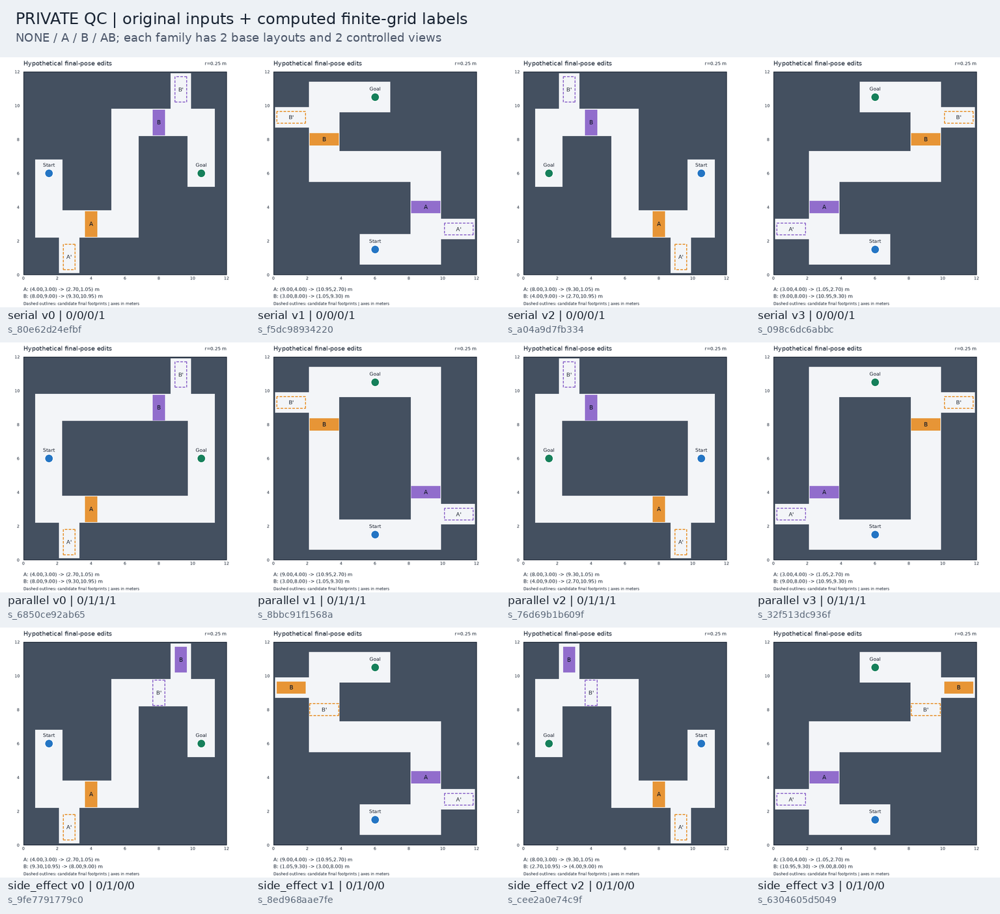

# EAI — Spatial Intervention Pilot

用于 VLM 空间可执行性与假设场景编辑诊断的离线先导实验。目前完成 **Phase 0–2 / Checkpoint B**，
等待研究者检查场景和标签，再进行 VLM 部署。没有下载模型权重或进行训练。

全部项目文件位于 [`spatial_intervention_pilot/`](spatial_intervention_pilot/)，
Python 环境独立，不修改已有 inspection_robot、ROS2、NVIDIA 驱动或系统 CUDA。

- [项目结构与重现说明](spatial_intervention_pilot/README.md)
- [实验结果与限制](spatial_intervention_pilot/reports/pilot_summary.md)
- [工作站与环境审计](spatial_intervention_pilot/reports/environment.md)
- [62 项自动测试日志](spatial_intervention_pilot/reports/logs/tests.log)
- [六个核心实例的四状态对照图](spatial_intervention_pilot/reports/qc_core_edits.png)
- [原始模型输入](spatial_intervention_pilot/data/public_inputs.jsonl) / [几何真值](spatial_intervention_pilot/data/private_labels.jsonl)

三类各 4 个场景，共 12 个（其中 6 个核心实例）。48 个状态在 0.10 / 0.05 / 0.025m 网格上的可达标签一致；
独立重生成的 26 个数据文件逐字节一致，生成失败 0、oracle 未决 0。

| 场景类型 | NONE | A | B | A+B |
|---|---:|---:|---:|---:|
| 串联阻塞 | 0 | 0 | 0 | 1 |
| 替代路线 | 0 | 1 | 1 | 1 |
| 修改引入新阻塞 | 0 | 1 | 0 | 0 |



在 Linux 工作站重现：

```bash
cd /home/asus/EAI/spatial_intervention_pilot
bash scripts/bootstrap.sh   # 环境尚未建立时执行
bash scripts/run.sh all
```

随机种子为 `20261020`；Python、包版本、下载哈希、字体/GEOS 版本、生成时 Git commit 均有记录。
仓库不含 Python 运行时、venv 或缓存。“private_labels”和私有 QC 只是模型不可见的评估数据，
在本公开仓库中一并提供，禁止将它们放入 VLM 输入。

这些标签仅针对有限分辨率几何模型；F=0 不能证明连续空间不可达，编辑后可达也不等于能真实搬动物体。
12 张图含参数变化与受控旋转/镜像，尚不足以支持关于 VLM 的 H1/H2 研究结论。
