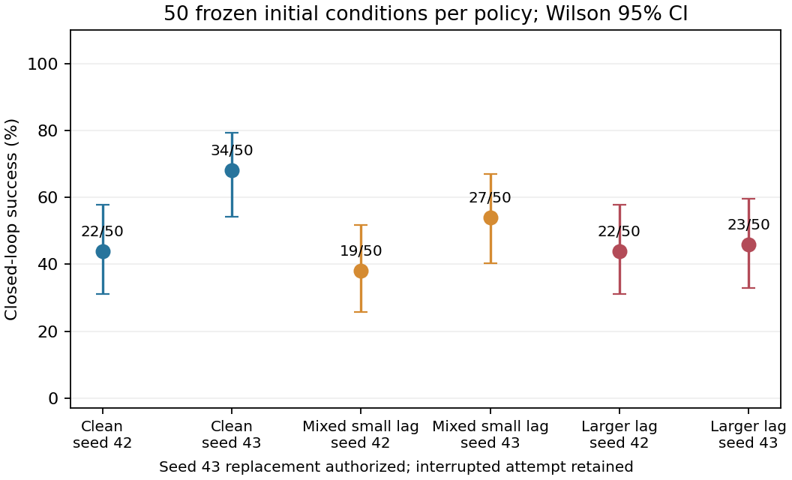
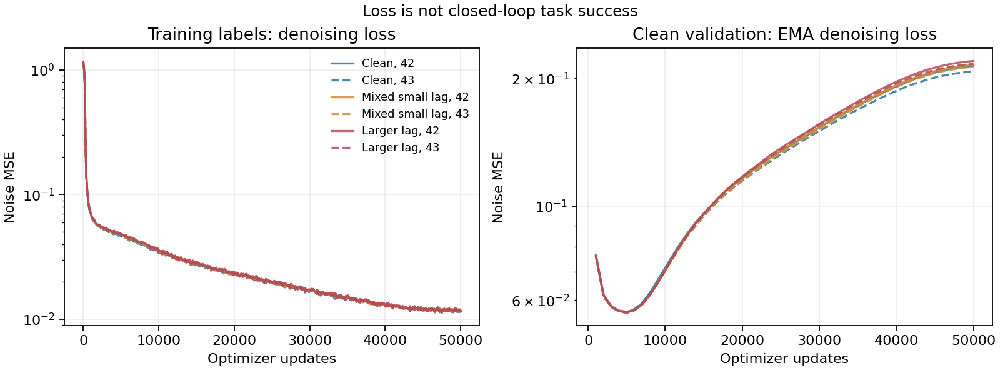

# Gate 1 闭环基线结果

共启动 7 次训练：6 次完成，1 次中断。只有完成 50,000 次更新的最后 EMA 才进入闭环评估，没有按测试表现选择 checkpoint。中断尝试保留日志和算力，不以失败回合替代缺失结果。

## 运行与资源

| 条件 | 已启动/完成训练（含归档） | 结果训练种子 | 训练 GPU 占用墙钟小时 | 正式评估回合 |
|---|---:|---|---:|---:|
| Clean | 2/2 | 42, 43 | 0.6581 | 100 |
| Mixed Small Lag | 2/2 | 42, 43 | 0.6602 | 100 |
| Larger-Lag Control | 3/2 | 42, 43 | ≥0.9180 | 100 |

完成的 6 次训练 GPU 占用墙钟 **1.9695 h**，中断训练已确认 **≥0.2668 h**，合计 **≥2.2363 h**；正式策略评估 **300 回合 / 120,000 控制步**；仿真及 reset CPU 墙钟 **1978.3s**；推理墙钟 **1369.5s**。

GPU 小时是本进程训练阶段占用设备的墙钟，包含该阶段验证和保存开销，不是 profiler 统计的纯 kernel 时间。CPU 墙钟是正式评估 env.step + reset 调用耗时，不是 CPU 核时。部署下载、源码审计、数据/重置验证开销不冒充训练资源。

研究者在 2026-10-23 明确授权 Larger seed 43 补跑一次，总尝试数由原预算六次扩至七次，仍只有原六个条件/种子组合。原 42,400 更新尝试保存在 `outputs/gate1/interrupted_attempts/`；`interruption.json`、归档文件及哈希保留，不删除或扣除其算力。补跑沿用全部 29 个冻结文件/manifest、相同 50,000 更新和 50 初态，未挑选多个完整候选。授权记录见 `retry_authorization.md`。

历史会话明确记录 2026-10-22 22:53:21 +08:00 的 `usage_limit_exceeded`，确认额度耗尽结束了智能体轮次。训练仍继续到 23:28:08；没有进程退出码，不能证明额度直接终止训练，也不归因为 OOM 或数值发散。证据见 `interruption_diagnosis.json`。

单独的 GPU 部署 smoke 为 0 optimizer updates；原始示教 replay 和冻结初态检查不计为策略评估。所有已执行正式评估均为同一批 50 个初态、每回合完整 400 步，首次成功后继续到 400 步。

## 每个实际结果

| 条件 | 训练 seed | 最后确认更新数 | 成功/回合 | 成功率及 Wilson 95% CI | 最后训练 noise MSE | 最后 EMA clean-valid MSE（更新） | 峰值分配/保留显存 GiB |
|---|---:|---:|---:|---|---:|---|---|
| Clean | 42 | 50000 | 22/50 | 44.0% [31.2, 57.7] | 0.01157 | 0.21400 (50,000) | 0.659/0.719 |
| Clean | 43 | 50000 | 34/50 | 68.0% [54.2, 79.2] | 0.01128 | 0.20762 (50,000) | 0.659/0.719 |
| Larger-Lag Control | 42 | 50000 | 22/50 | 44.0% [31.2, 57.7] | 0.01165 | 0.21985 (50,000) | 0.659/0.719 |
| Larger-Lag Control | 43 | 50000 | 23/50 | 46.0% [33.0, 59.6] | 0.01127 | 0.21646 (50,000) | 0.659/0.719 |
| Mixed Small Lag | 42 | 50000 | 19/50 | 38.0% [25.9, 51.8] | 0.01167 | 0.21557 (50,000) | 0.659/0.719 |
| Mixed Small Lag | 43 | 50000 | 27/50 | 54.0% [40.4, 67.0] | 0.01129 | 0.21295 (50,000) | 0.659/0.719 |

训练 loss 是对本条件标签的扩散噪声预测 MSE；验证始终采用相同的 clean valid 数据。二者均不是动作执行误差或闭环成功率。过拟合迹象应与正式闭环结果一并阅读。

## 配对比较

正差表示 Clean 成功率更高；同一个测试 seed 的两结果成对。

| 污染条件 | 训练 seed | Clean−污染 pp | 初态配对 bootstrap 95% CI pp | Clean-only / 污染-only 成功 | 该种子达到数值标准 |
|---|---:|---:|---|---:|---|
| Larger-Lag Control | 42 | 0.0 | [-16.0, 16.0] | 9/9 | False |
| Larger-Lag Control | 43 | 22.0 | [8.0, 36.0] | 13/2 | True |
| Mixed Small Lag | 42 | 6.0 | [-8.0, 22.0] | 9/6 | False |
| Mixed Small Lag | 43 | 14.0 | [-4.0, 32.0] | 15/8 | False |

| 污染条件 | 两种子平均下降 pp | 共同初态聚类 bootstrap 95% CI pp | 整个条件达到 Step D 门槛 |
|---|---:|---|---|
| Larger-Lag Control | 11.0 | [1.0,22.0] | False |

Larger-Lag Control 有单种子的实质损害信号，应保留报告；条件层面的跨种子重复性门槛仍未通过。平均值区间只反映当前固定策略的初态差异，不能覆盖训练种子总体方差，也不能取代预登记的两个种子要求。

| Mixed Small Lag | 10.0 | [-3.0,22.0] | False |

门槛为同一污染条件的两个训练种子均下降至少 10pp，且每种子配对区间下界大于零。聚类初态 bootstrap、精确 McNemar 结果及完整 discordant counts 在 `outputs/gate1/comparison.json`。

50 初态和两个训练种子不足以排除 1–3pp 等小效应。区间只反映这些固定策略对测试初态的不确定性，不能估计训练随机性总体方差，也不是所有模仿学习系统的结论。

## 辅助行为与原始记录

| 条件/seed | 平均夹爪符号翻转 | 平均动作相邻差范数 | nut 低于桌面代理回合 |
|---|---:|---:|---:|
| clean_seed42 | 11.74 | 0.2319 | 0 |
| clean_seed43 | 13.82 | 0.2369 | 0 |
| larger_lag_seed42 | 7.64 | 0.2121 | 0 |
| larger_lag_seed43 | 10.68 | 0.2225 | 0 |
| mixed_small_lag_seed42 | 12.10 | 0.2215 | 0 |
| mixed_small_lag_seed43 | 13.76 | 0.2245 | 0 |

这些是完整 400 步的辅助代理，可能包含成功后的行为；接触数/高度/抖动不能自动等同于已人工确认的接触错误。逐回合原始成功、首次成功步、重置误差、动作变化和耗时在每个 run 的 `evaluation.jsonl`。完整低维动作/状态 trace 为本地 `outputs/gate1/trajectories/` 的 NPZ，路径和 SHA256 随原始行记录。

`paired_outcomes.csv` 保留按测试初态并排的 0/1 结果；所有训练 update 的 loss 在 `metrics.jsonl`。本地 checkpoint 路径、SHA256、配置和代码版本在各 `run.json`。模型权重、optimizer、原始 HDF5、虚拟环境和缓存均未进入 Git。

## 适用范围

本实验使用同一个 Square PH 任务、原始相对控制命令及 16 维未改写的同步原始状态分量。训练前已排除官方 object 里缓存依赖的相对派生分量，详见时间约定及修订清单。因此不等于复现论文 23 维/绝对动作版本，也不支持 RGB 时间戳错误或真实机器人日志分布的推断。
