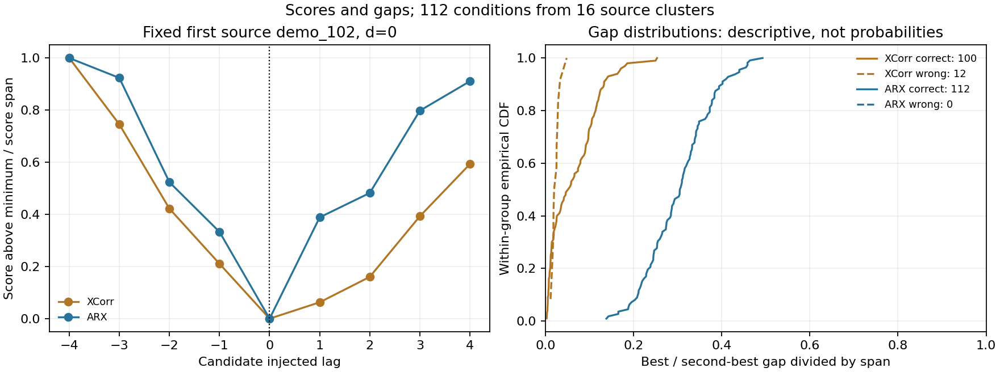
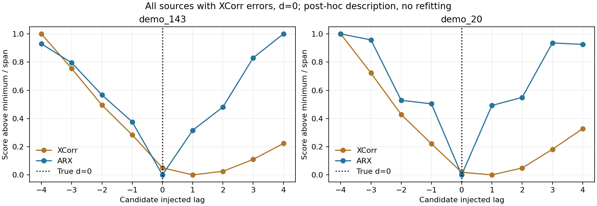

# 分数与剩余歧义诊断

不存在两种固定基线均无法修复的留出错误：ARX 的硬 MAP 全部正确。互相关呈现有信息的多候选曲线，但不能把较弱基线的失败直接当作后验监督必要性。

| 方法 | true lag 平均中秩 | top3覆盖 | 合理集覆盖 | 平均合理集大小 | ambiguous | flat | unreliable |
|---|---:|---:|---:|---:|---:|---:|---:|
| XCorr | 1.160714 | 100.00% | 97.32% | 1.616071 | 54.46% | 0.00% | 25.00% |
| ARX | 1.000000 | 100.00% | 100.00% | 1.000000 | 0.00% | 0.00% | 18.75% |

两方法 top3=100%，高于九候选均匀 top3=33.33% 与预固定先验 top3=42.86%。相对固定先验的 episode 聚类差异为 57.14pp；该退化区间只反映这 16 条观测来源，不是总体零方差。ARX 的合理集全部为正确 singleton，未出现需要混合标签的残余近似并列。

XCorr 12 个错误的 true lag 中秩均为 2 或 3，9/12 仍在近似合理集中。其 normalized gap 全在 0.05 以下，具有描述性诊断意义；但全部错误均被同一预登记 ARX 硬估计消除，不满足潜在 Go 所需的跨来源、两方法均失败条件。

## 预固定 margin bins

| 方法 | normalized gap 区间 | 条件数 | 所涉独立来源 | exact |
|---|---|---:|---:|---:|
| XCorr | [0.00,0.05) | 61 | 11 | 80.33% |
| XCorr | [0.05,0.20) | 49 | 16 | 100.00% |
| XCorr | [0.20,1.00] | 2 | 2 | 100.00% |
| ARX | [0.00,0.05) | 0 | 0 | N/A |
| ARX | [0.05,0.20) | 8 | 4 | 100.00% |
| ARX | [0.20,1.00] | 104 | 16 | 100.00% |

unreliable 是 best residual 高于 8 锚点 OOF q95 或模型失配的启发式标记。ARX 有 21/112 个条件被标记但 lag 仍全部正确；XCorr 的 12 个错误均未被该绝对残差阈值标记。它不能当作已校准错误概率或充分拒绝规则。tau 来自锚点，未为覆盖留出真值调整。

没有输出残差 Softmax，没有训练概率后验。这里既不能证明概率校准，也不能证明所有实际日志中不存在歧义；只能说当前轨迹和固定整步注入下，最简单的短历史响应硬修复已足够。

下图包含全部出现 XCorr 错误的来源，统一画 d=0，不挑最有利子片段；仅为揭盲后的描述，不改模型。

