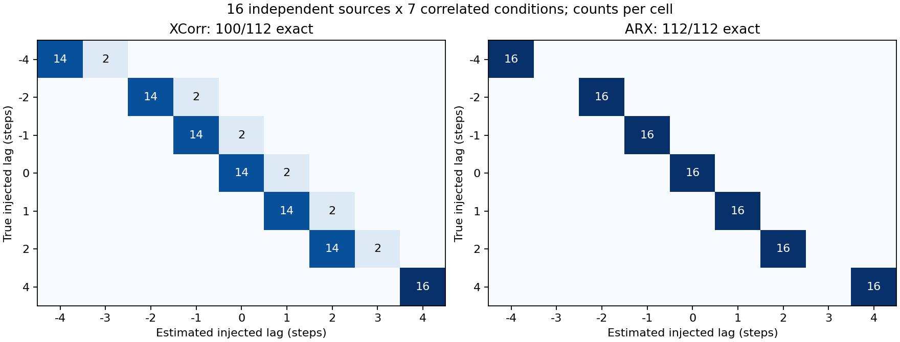

# Lag 识别结果

112 个条件来自 16 条固定独立来源；以下区间均按来源聚类重采样 10,000 次。没有把 112 当成独立示教。

| 方法 | Exact | 95% 来源聚类 CI（%） | MAE 步 | MAE ms | 预测 ±3 | d=0 误修复 |
|---|---:|---|---:|---:|---:|---:|
| XCorr | 100/112 (89.29%) | [73.21,100.00] | 0.107143 | 5.3571 | 4/112 | 12.50% |
| ARX | 112/112 (100.00%) | [100.00,100.00] | 0.000000 | 0.0000 | 0/112 | 0.00% |
| Zero / no correction | 16/112 (14.29%) | [14.29,14.29] | 2.000000 | 100.0000 | 0/112 | 0.00% |

ARX 的 [100,100]% 是当前经验分布重采样的退化区间，**不是总体准确率为 100% 的置信保证**。16 条来源仍不足以证明真实机器人日志普遍可恢复。Zero 的固定率由每源七种平衡注入决定，不是额外泛化证据。

| true d | XCorr exact /16 | ARX exact /16 | Zero exact /16 |
|---:|---:|---:|---:|
| -4 | 14 | 16 | 0 |
| -2 | 14 | 16 | 0 |
| -1 | 14 | 16 | 0 |
| 0 | 14 | 16 | 16 |
| 1 | 14 | 16 | 0 |
| 2 | 14 | 16 | 0 |
| 4 | 16 | 16 | 0 |

| 原 episode | XCorr exact /7 | ARX exact /7 | XCorr 错误模式 |
|---|---:|---:|---|
| demo_102 | 7 | 7 | 无 |
| demo_11 | 7 | 7 | 无 |
| demo_113 | 7 | 7 | 无 |
| demo_117 | 7 | 7 | 无 |
| demo_12 | 7 | 7 | 无 |
| demo_133 | 7 | 7 | 无 |
| demo_143 | 1 | 7 | -4→-3, -2→-1, -1→0, 0→1, 1→2, 2→3 |
| demo_158 | 7 | 7 | 无 |
| demo_159 | 7 | 7 | 无 |
| demo_162 | 7 | 7 | 无 |
| demo_165 | 7 | 7 | 无 |
| demo_169 | 7 | 7 | 无 |
| demo_20 | 1 | 7 | -4→-3, -2→-1, -1→0, 0→1, 1→2, 2→3 |
| demo_6 | 7 | 7 | 无 |
| demo_76 | 7 | 7 | 无 |
| demo_96 | 7 | 7 | 无 |

互相关错误仅在 demo_143 和 demo_20，各六个条件均偏估 +1 步；+4 条件在候选上界取 +4。后者可能受搜索边界截断影响，不能把未扫描的 +5 最优值当成观测事实，也不增加候选范围重跑。ARX 在全部原 episode 的七条件均正确。

完整九候选原始分数为 `predictions.jsonl`；带真值的评分、逐源数据及 CSV 为 `scored_cases.jsonl`、`by_episode.json`、`by_episode_summary.csv`。

