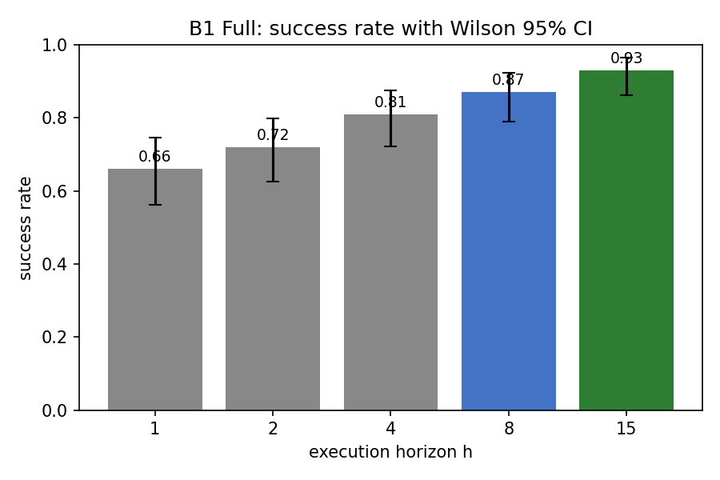
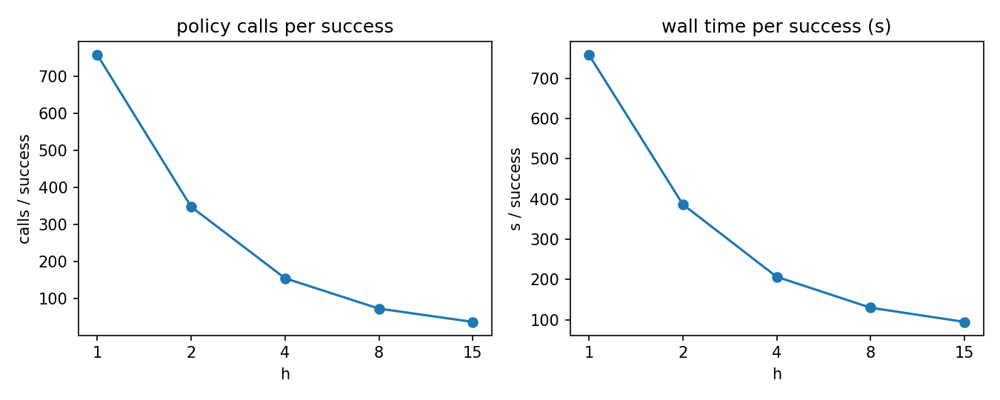

# B1 Full report — formal fixed execution-horizon scan

Date: 2026-11-13 12:02 to 2026-11-14 19:55 (Asia/Shanghai).
Branch/commit at execution: `codex/gate-b-v2`, `2fe5cc93c25d6ec67ccea0520e2d260a4273ced7`.
Run directory: `runs/gateb_b1_full_20261113T0400Z/`.
Status: **B1 FULL COMPLETED — data valid; research judgment: CONDITIONAL GO for
B2 preparation. B2 was not executed.**

## 1. Purpose

B1 Full estimates whether the number of predicted actions executed before
re-observation changes task success and execution cost under one locked
Diffusion Policy checkpoint and environment. B1 tests global fixed-horizon
effects; it does not test state-dependent clearance adaptation and does not
prove CAC.

## 2. Fixed protocol

| Item | Value |
|---|---|
| Phase | B1 Full |
| Initial states | 100 |
| Seeds | 200020–200119 |
| Horizons | `[1, 2, 4, 8, 15]` |
| Episodes | 500 (100 × 5) |
| Max steps | 500 |
| Reference horizon | h=8 |
| Policy seed | 700000 + seed (900020–900119) |
| Device | `cuda:0` |
| Success | final-state robomimic `is_success()["task"]` |
| Action interface | 10-D absolute → 7-D OSC_POSE, `control_delta=false` |
| H / To | 16 / 2 (15 executable future actions) |

No custom path, checkpoint, dataset, step, horizon, seed or statistical
threshold was supplied. The run used the fixed project config and the locked
manifests.

## 3. Environment and assets

| Item | Value |
|---|---|
| GPU | NVIDIA GeForce RTX 3090, 24,576 MiB |
| Driver | 580.178.04 |
| PyTorch / CUDA | 1.12.1+cu116 / 11.6 |
| robomimic / robosuite | 0.2.0 / 1.2.0 |
| mujoco_py | 2.0.2.13 |
| Python | 3.9.13 |
| Renderer | OSMesa 23.2.1 |
| Checkpoint SHA256 | `adaf17854fb8ff8acaccc56adbf6af321c7bec7fecb22de5257772ec81927c6d` |
| Dataset SHA256 | `7e58906366d79996f13785ff2dd0fe346230373532addc2afc7c92611ae42887` |
| DP source tree SHA256 | `aec43e20abb0902b606e61fc4a391605ab755e59233ecb5f6bdbfbe8df372f21` |
| Critical config fingerprint | `b34de158b416d6cbcc84dfc6bd0a3eb826461f5a7a9d662d236c1b210cd1bcec` |
| Environment | `NutAssemblySquare` |

The locked environment check passed before the run manifest was written.

## 4. Completion and integrity

| Check | Result |
|---|---|
| Episodes completed | **500/500** |
| JSONL SHA256 | `8bc92e88fdb497de6df0d54fb11a84da9fae3b6b66c306a574d4f45a914bf96e` |
| Seeds | 200020–200119, 100 unique, no gaps |
| Horizons per seed | exactly `[1,2,4,8,15]` |
| Duplicate `(seed, horizon)` | none |
| Steps | all 500 |
| Policy calls | exactly `{1:500, 2:250, 4:125, 8:63, 15:34}` |
| Initial-state pairing | 100 unique hashes; five horizons equal per seed |
| `paired_initial_state_verified` | true for all 500 rows |
| Environment fields vs manifest | match for all 500 rows |
| Policy seed formula | true for all rows |
| `success_error` | none |
| Sticky/final success difference | none |
| Terminations | all `max_steps` |
| NaN/Inf/CUDA/OOM/renderer errors | none |
| Analysis completeness gate | passed (`completeness_verified=true`) |

Run duration: 31.896 h wall clock; summed episode wall time 31.875 h.

## 5. Results by horizon

| h | Successes / N | Rate | Wilson 95% CI | Mean policy calls | Mean wall time |
|---:|---:|---:|---|---:|---:|
| 1 | 66/100 | 0.660 | [0.563, 0.745] | 500.00 | 500.81 s |
| 2 | 72/100 | 0.720 | [0.625, 0.799] | 250.00 | 278.47 s |
| 4 | 81/100 | 0.810 | [0.722, 0.875] | 125.00 | 167.38 s |
| 8 | 87/100 | 0.870 | [0.790, 0.922] | 63.00 | 112.93 s |
| 15 | 93/100 | 0.930 | [0.863, 0.966] | 34.00 | 87.92 s |

Failure counts by horizon: h=1 34, h=2 28, h=4 19, h=8 13, h=15 7; 101 total.
Failure seed lists are in `reports/b1_full_failure_seeds.json`. All failures
are ordinary task failures at the 500-step limit and are retained.

## 6. Pre-registered statistics

**Overall Cochran's Q:** Q=34.2000, df=4, **p=6.78×10⁻⁷**. The five horizons
differ globally at alpha=0.05.

**Paired comparisons vs h=8** (cluster bootstrap over initial-state seeds,
exact McNemar, Holm correction over four comparisons):

| h | Risk difference | Bootstrap 95% CI | Raw McNemar p | Holm p | Practical ≥0.08 |
|---:|---:|---|---:|---:|---|
| 1 | −0.210 | [−0.320, −0.110] | 0.000324 | **0.001296** | yes |
| 2 | −0.150 | [−0.250, −0.050] | 0.008130 | **0.024390** | yes |
| 4 | −0.060 | [−0.150, 0.030] | 0.263176 | 0.420227 | no |
| 15 | +0.060 | [−0.010, 0.140] | 0.210114 | 0.420227 | no |

- h=1 and h=2 are significantly worse than h=8 after Holm correction, with
  effects larger than the pre-registered 8 pp practical threshold.
- h=4 is not significantly different; its −6 pp point estimate is below the
  practical threshold.
- h=15 is not significantly different; its +6 pp point estimate is below the
  practical threshold and its CI includes zero. It must not be reported as
  significantly better than h=8.
- Maximum absolute pairwise rate difference: 0.27 (h=1 vs h=15).
- Ceiling effect: false. Floor effect: false (rates 0.66–0.93).

## 7. Efficiency

| h | Calls / episode | Wall / episode | Total calls | Total wall | Calls / success | Wall / success |
|---:|---:|---:|---:|---:|---:|---:|
| 1 | 500 | 500.81 s | 50,000 | 50,080.8 s | 757.6 | 758.8 s |
| 2 | 250 | 278.47 s | 25,000 | 27,847.4 s | 347.2 | 386.8 s |
| 4 | 125 | 167.38 s | 12,500 | 16,737.9 s | 154.3 | 206.6 s |
| 8 | 63 | 112.93 s | 6,300 | 11,292.8 s | 72.4 | 129.8 s |
| 15 | 34 | 87.92 s | 3,400 | 8,792.2 s | 36.6 | 94.5 s |

h=15 versus h=8: +6 pp success (CI −1 to +14, not significant), 46.0 % fewer
policy calls, 22.1 % less wall time, 49.5 % fewer calls per success and 27.2 %
less wall time per success. The efficiency gain is large; the success
superiority is not statistically established.

h=1 versus h=8: −21 pp success, 8× the calls and 4.4× the wall time per
episode. h=2: −15 pp, 4× calls and 2.5× wall time. h=4: −6 pp (not
significant), 2× calls and 1.5× wall time.

## 8. GPU, thermal and runtime monitoring

| Metric | During-run value |
|---|---|
| Samples (10 s) | 11,451 |
| GPU utilization max / mean | 91.0 % / 65.49 % |
| GPU memory max / mean | 3,550 / 3,548.5 MiB |
| GPU temperature max / mean | 86 °C / 82.01 °C |
| GPU power max / mean | 326.77 W / 281.5 W |
| SM clock max / mean | 1,935 / 1,799.6 MHz |
| Throttle reasons | SW power cap (0x4) 3,499 samples; SW thermal slowdown (0x20/0x24) 7,094 samples; no HW thermal (0x10) or HW slowdown (0x8) |

The run was thermally stable but frequently hit software thermal slowdown
(about 62 % of samples) and power cap; clocks averaged 1,799.6 MHz. There was
no hardware thermal protection event, no CUDA error, no OOM and no abnormal
termination. The raw monitor log is committed as
`reports/gpu_monitor_b1_full_raw.log.gz`; the summary is
`reports/gpu_monitor_b1_full_summary.json`.

## 9. Pilot versus Full

| h | Pilot rate (n=20) | Full rate (n=100) | Full − Pilot |
|---:|---:|---:|---:|
| 1 | 0.75 | 0.66 | −0.09 |
| 2 | 0.70 | 0.72 | +0.02 |
| 4 | 0.85 | 0.81 | −0.04 |
| 8 | 0.90 | 0.87 | −0.03 |
| 15 | 0.90 | 0.93 | +0.03 |

The main Pilot trend is reproduced: h=1 and h=2 are below h=8, and h=15 is at
least as good as h=8. The Full sample makes the h=1 and h=2 deficits
statistically significant after correction; the Pilot alone did not. h=2
overtook h=1 slightly in Full, but both remain below h=8. Pilot data were not
pooled with Full.

## 10. Research questions

### Q1: Is there a global execution-horizon effect?

Yes. Cochran's Q=34.2, df=4, p=6.78×10⁻⁷. Full provides substantially stronger
evidence than the 20-state Pilot (Q p=0.1586).

### Q2: Are short horizons worse?

Yes, in this task. h=1 and h=2 are significantly worse than h=8 after Holm
correction (−21 pp and −15 pp). This reproduces the Pilot direction and
strengthens it. h=4 is numerically lower but not significant.

### Q3: Is h=15 efficient while preserving success?

h=15 achieved 93/100 versus 87/100 for h=8 (+6 pp, CI −1 to +14, not
significant) while using 34 versus 63 calls per episode and 87.9 versus
112.9 s. It is **non-inferior and substantially cheaper** in this sample; it
is not statistically superior in success. Fixed long-horizon execution is a
strong efficiency baseline.

### Q4: Does B1 support continuing CAC research?

B1 establishes that global execution horizon matters, but CAC is a
**state-dependent** claim: it requires that local geometry/clearance predicts
when a short or long commitment is better. B1 does not test this interaction.
The strong h=15 baseline raises the bar: a CAC method must demonstrate a
state-level benefit (or an efficiency benefit at equal success) beyond simply
using h=15. B1 is therefore supportive of horizon relevance but does **not**
prove CAC.

### Q5: How should B2 proceed?

B2 is not started. If pursued, it should:

- test a horizon × clearance interaction, not another global scan;
- include h=15 as a strong fixed baseline in addition to h=8;
- freeze the insertion-stage window before looking at outcomes;
- pass deterministic snapshot/restore replay on the real simulator;
- collect states in a separate authorized step, with discovery/confirmation
  disjoint and multiple stochastic repeats;
- focus on states where h=15 fails or is uncertain, and test whether clearance
  predicts a short-horizon benefit;
- keep the pre-registered cluster/interaction analysis and avoid selecting
  thresholds on held-out outcomes.

No insertion window or threshold was frozen in this round and no B2 state was
collected.

## 11. Final judgment

**CONDITIONAL GO.**

- B1 Full is complete, internally valid and reproducible.
- The global horizon effect is real: short horizons (1, 2) significantly reduce
  success; h=15 is non-inferior to h=8 and much cheaper.
- CAC's state-dependent hypothesis remains untested. B2 is worth preparing only
  with h=15 as an explicit strong baseline, a frozen insertion window and a
  validated snapshot/restore pipeline.
- This is not a GO for CAC itself, and it does not justify changing the
  pre-registered B1 protocol or retrofitting a threshold.

## 12. Limitations

- B1 is one checkpoint, one task, one training seed and one GPU environment.
- The h=15 success advantage is not statistically significant; only the h=1
  and h=2 deficits are Holm-significant.
- Success and efficiency are measured over 500-step episodes; policy-call
  savings do not translate one-to-one into robot execution-step savings.
- B1 cannot identify state-level heterogeneity or clearance effects.
- The GPU experienced sustained software thermal throttling; this affects
  wall-clock comparisons but not the success labels or pairing.

## 13. Evidence

- `reports/b1_full_episodes.jsonl` (500 rows, SHA256 above)
- `reports/b1_full_run.json`
- `reports/b1_full_environment_manifest.json`
- `reports/b1_full_analysis.json`
- `reports/b1_full_ANALYSIS.md`
- `reports/b1_full_failure_seeds.json`
- `reports/b1_full_efficiency.json`
- `reports/b1_full_success_rate.png`
- `reports/b1_full_efficiency.png`
- `reports/b1_full_run.log.txt`
- `reports/gpu_monitor_b1_full_summary.json`
- `reports/gpu_monitor_b1_full_raw.log.gz`
- raw run directory `runs/gateb_b1_full_20261113T0400Z/` (Git-excluded)
