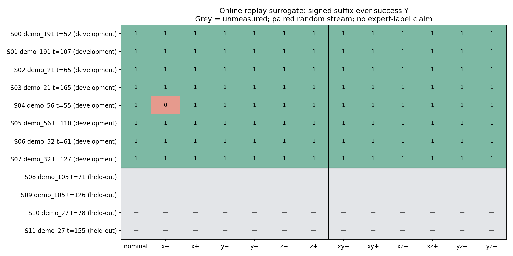

# L-B结果：信息不足，关闭L-B3

本轮测量对象是在线重放得到的proxy state和一次log-action proxy干预，后续使用冻结
Clean42与相同随机流。技术L-A通过；科学执行在L-B2完成后按预登记第5节规则4停止：
`Stop: directional information from fewer than two dev sources`。
这不是新的Engineering blocked，也不是对所有M方法的普遍反证。

| 阶段 | 冻结计划 | 实际完成 | 结果 |
|---|---:|---:|---|
| L-A | 4 | 4 | 两对零重复一致，技术Go |
| L-B1 | 56 | 56 | 仅S04 −x失败，允许混合方向检查 |
| L-B2 | 48 | 48 | 48条全部成功，仍只有1个信息来源，停止 |
| L-B3 | 52 | 0 | 门槛关闭，4个held-out状态均未测 |
| 总计 | 160 | 108 | 52个槽位保持未运行，Y为空 |

## 全部方向结果

Y为固定完整suffix中的官方ever-success；本轮ever与final逐支相同。表中每对按
−、+顺序，不平均符号，不将观察到的二元后果当作连续Q或成功概率估计。

| 状态 | 来源 | 名义Y | x−/+ | y−/+ | z−/+ | xy−/+ | xz−/+ | yz−/+ |
|---|---|---:|---|---|---|---|---|---|
| S00 | demo_191 | 1 | 1/1 | 1/1 | 1/1 | 1/1 | 1/1 | 1/1 |
| S01 | demo_191 | 1 | 1/1 | 1/1 | 1/1 | 1/1 | 1/1 | 1/1 |
| S02 | demo_21 | 1 | 1/1 | 1/1 | 1/1 | 1/1 | 1/1 | 1/1 |
| S03 | demo_21 | 1 | 1/1 | 1/1 | 1/1 | 1/1 | 1/1 | 1/1 |
| S04 | demo_56 | 1 | **0/1** | 1/1 | 1/1 | 1/1 | 1/1 | 1/1 |
| S05 | demo_56 | 1 | 1/1 | 1/1 | 1/1 | 1/1 | 1/1 | 1/1 |
| S06 | demo_32 | 1 | 1/1 | 1/1 | 1/1 | 1/1 | 1/1 | 1/1 |
| S07 | demo_32 | 1 | 1/1 | 1/1 | 1/1 | 1/1 | 1/1 | 1/1 |
| S08–S11 | 2个held-out来源 | 未测 | 未测 | 未测 | 未测 | 未测 | 未测 | 未测 |

8个名义分支全成功；96个扰动中95个成功、1个失败；4条A重复也全成功。
DeltaY=Ynom−Ypert：唯一非零为LB1_S04_x_-1的+1，没有−1改善。
4个开发来源中只有demo_56提供1个有信息状态，且只有x方向出现符号不对称。
这未达到事先要求的至少2来源方向初证，也未达到至少2来源且至少2方向的强PSD拒绝。
阶段内没有按中间结果停选状态，B1/B2完整执行，未增加噪声重复来挽救模型。

## 简单基线与PSD的证据边界

完整6方向设计特征秩为6，B1轴向设计秩为3；设计秩不等于信息足以估参。
本次只在同一个来源的一个状态有failed/safe排序对，低于冻结的2来源资格。
因此没有拟合world-full、object-full、task-full或contact-full矩阵，也没有冻结供B3
使用的参数；它们既未获充分性证据，也未被击败。不能以一个failed分支证明学习M必要。

scalar对等模长方向给出全tie；唯一信息状态内有11个failed/safe方向对，全部tie，
这是可直接计算的低容量参照。其余全成功状态没有排序对，不能算基线“100%排序正确”。
任何对称二次型都满足q(d)=q(−d)，所以S04的−x/+x这一个signed pair无法由其确定性
score区分；这一孤立、单随机流结果只作弱预警，不放大成总体概率对称性反证。

接触frame严格按原生接触力法向判据：7/8开发状态可用，S02因法向二阶矩模糊而不可用。
contact可用不等于有足够监督信息，也不证明接触坐标已充分或被击败。task/peg frame
本身接近world固定框架，不虚构独立优势。无held-out结果，不计算或捏造泛化性能。

原始分母见all160_allocations_actual.csv与all12_states_actual.csv；逐符号结果见
signed_outcomes.csv，来源层级见episode_summary.csv，矩阵状态见baseline_evaluation.json。
完整轨迹与noise/history通过trace_index.csv定位；不存在平均±后掩盖符号差异的主表。

本轮运行期间曾有一条进度文字将未完成汇总误读为“改善”；B1正式汇总时已明确更正。
原始结果、冻结门槛与执行过程未因此改变，正式数据中改善始终为0。
