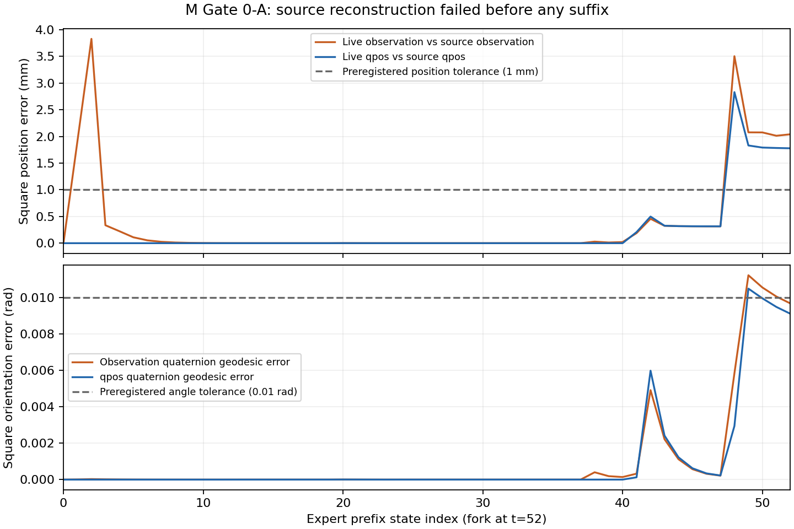

# Gate A：专家状态重建未通过

结论：**Invalid / Engineering blocked**。首个预选状态 S00（demo_191，t=52，grasp）
的完整专家前缀超过事前容差。仅执行52个专家动作，在执行 a*_52 或冻结策略之前停止。
没有完成任何 suffix，也没有完成零扰动重复对，不能声称重复成功一致或出现成功翻转。

| 检查量 | 前缀最大误差 | 分叉点 t=52 | 预登记容差 |
|---|---:|---:|---:|
| selected_observation_max_abs | 0.00486073457 | 0.00471790973 | 0.001 |
| eef_position_m | 0.000992366229 | 0.000438722724 | 0.001 |
| object_position_m | 0.00382977724 | 0.00204085861 | 0.001 |
| eef_rotation_rad | 0.00151342872 | 0.000810223671 | 0.01 |
| object_rotation_rad | 0.0112379042 | 0.00968974473 | 0.01 |
| state_max_abs | 0.931848663 | 0.0183992204 | 0.01 |
| time_s | 0 | 0 | 1e-08 |

初态45维仿真 state 逐字节一致，所有52个控制器收到的前缀动作与原专家动作逐字节一致，
时间误差为0。分叉点 source state hash 为
`12e65b9e7f5d03e071877fd64755361e292d6a69ce48ee61a1268441736a8a9d`，live state hash 为
`4a52c52d55e7e1ff6e1de3f76b56b3122b2dd50843c70a789b254b5f26f6ae09`。完整 controller/cache/history/RNG 哈希在分支JSON中。

一次有界只读诊断只分析已保存的 trace，没有新增模拟步或后缀：

- t=2 的观测物体位置误差3.829777mm，而仿真 qpos 中物体位置误差约
  2.14e-09m；早期差主要来自在线观测缓存时序。
  原始HDF5的绝对物体观测与其 qpos 位置逐项一致。在线 step 返回的绝对物体观测也有
  缓存滞后，排除旧相对字段并未消除此处差异。
- t=52 仿真 qpos 本身的物体位置误差为
  1.778535mm，前缀最大为
  2.831569mm；因此不能只靠观测刷新解释失败。
- 原始state最大差0.931848663出现在t=42、flat index36，对应SquareNut自由关节
  x角速度（rad/s），不是0.93米的位置误差。接触附近物理漂移的具体根因尚未确定。
- 当前使用官方包装器 reset_to(initial XML/state) 并重放真实动作前缀；其model路径内部reset。
  官方action playback另有外层env.reset，本轮没有据此重跑，不能声称控制器初始内部状态
  与采集时完全一致。上游播放器也检查并警告action replay与记录state的差异。
  仅有states/actions并不保证
  完整控制器、积分器和观测缓存状态可被精确重建。不能据现有证据断言warm-start、版本或
  控制器中任何一个就是根因。M分支未更改这些接口或源数据。

图中橙线比较策略实际可用观测与源观测；蓝线比较仿真qpos。旋转均为四元数测地角，
不是四元数分量相减。逐步数值见 outputs/gate0/prefix_fidelity_by_step.csv。
原始NPZ仅本地保存，SHA256=`a017402444ed30301beb94c1c2b3aaeb1c1403b57af9adf4cba02e17771ead03`。

不放宽阈值、不替换S00、不传送到t、不继续专家后缀、不执行额外修复试验。
24条A主计划中仅首条尝试了前缀，其余23条及所有120条B均列为未执行。
若研究者以后批准重建排错，应先解决观测采样和物理重放差异，再独立登记；本轮到此停止。
