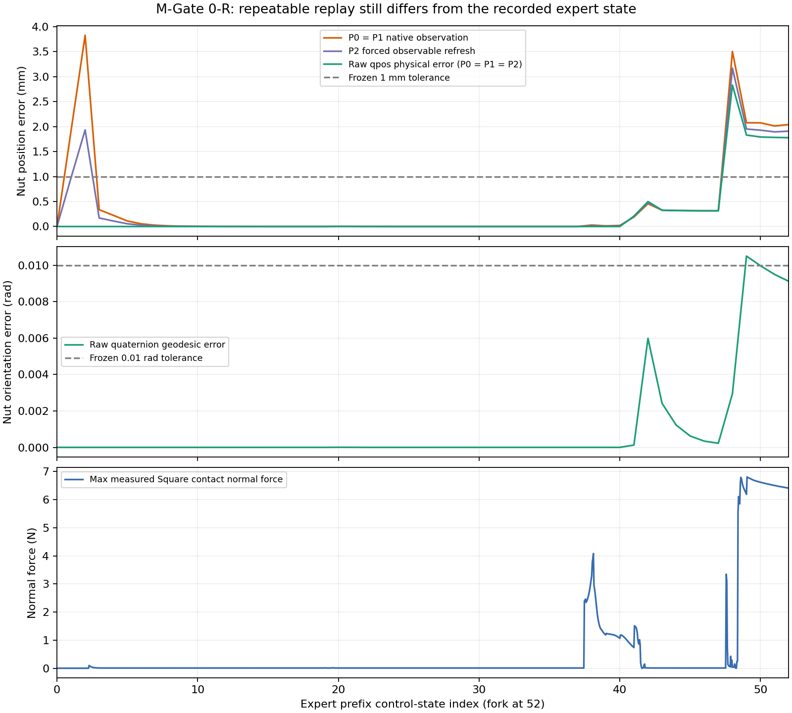

# Reset、传感器与物理重放诊断

结论：P0/P1/P2在本次专家前缀的物理轨迹逐字节一致，原示教状态重建仍失败。
同步观测消除了早期缓存时序差，但后期直接qpos位置/姿态及qvel仍超阈值。

| 路径 | 初始化/观测访问 | 新前缀次数 | 对照结果 |
|---|---|---:|---|
| P0 | 旧reset_to(model,state)，native step obs | 0（沿用封存trace） | 旧Invalid不变 |
| P1 | 外层reset→reset_to，native obs；只读克隆动力学观测 | 1 | 与P0全部53个state、53个native obs、52个收到动作逐字节一致 |
| P2 | P1初始化；每边界额外get_observation强制刷新缓存 | 1 | 与P1全部53个物理state逐字节一致；仅观测/采样时钟变化 |

两条新前缀均完成52步，无异常、无裁剪改写、无策略调用。P0是历史对照，未重新运行。
外层reset没有改善此来源/随机流的重建；这不证明所有任务/版本中两种reset都等价。
P1/P2每个边界的controller/warmstart数值亦相同，原示教未保存这些量，无法作源对源比较。

## 缓存差异的实测分解

独立MjData、mj_kinematics从全部53个source states导出的16D，与原HDF5选中16D逐项相等
（max error=0）。沿用EEF site位置、EEF body四元数及原gripper qpos；没有替换为site quat。
每次observer前后live time/qpos/qvel/act/warmstart/ctrl hash一致，未调用live forward。

t=2，native nut位置误差3.829777mm；P2强制刷新后1.933694mm；原始物理qpos误差仅
约2.14e-9m。强制刷新观测不能使body/site派生数据跟随最终积分qpos：

- t=1控制边界0.050s，P1 native nut数值精确匹配0.046s子步前qpos；P2 forced数值
  精确匹配0.048s子步前qpos（均按16D的float32比较，max=0）。
- t=2边界0.100s，对应native=0.096s、forced=0.098s。缓存采样在最后边界前2ms调用，
  读取的body pose又来自上一轮forward，形成这里测得的4ms有效位置滞后；仅force后仍为2ms。

这些对应关系来自本轮保存的子步qpos和传感器调用时刻，没有新增状态重放。
不把所有阶段都概括为固定4ms延迟；静止值也不能唯一反推采样时刻。

## t38～52：真实接触段偏离

qpos直接计算：t40 nut位置误差约0.000277mm，t41增至0.207630mm，t42约0.498853mm；
t48达到2.831569mm，t52仍1.778535mm。t49四元数测地角最大0.010503221rad。
source与live时间完全一致。state max0.931848663是t42 SquareNut自由关节x角速度差(rad/s)，
不能解释成米。qpos、机器人/夹爪/物体线速度和角速度分项见CSV。

动作40（导致state41）开始专家gripper命令由-1变+1，内部gripper累积控制逐步变化；
动作41的ncon在1～21间变化，SquareNut_g3与两个finger及table有接触。
动作47（导致state48）ncon在20～58间变化，并出现finger1 pad与SquareNut_g4接触；
该步所选Square接触峰值normal force约3.346282N。接下来动作48峰值约6.795927N。
接触峰值对应点/法向/力矩及force×dt代理均保存在contact_peaks38_52.csv。

这些是本次replay的真实接触数据，说明误差放大与接触转换时间邻近；源demo没有同样数据，
不能证明该接触法向、warmstart或某个goal就是漂移根因，也不能证明与采集时接触相同。
原始逐子步qpos/qvel/warmstart/ctrl、目标/参考值/更新标志、接触点与sensor缓存在本地
substeps.jsonl.gz及boundaries.json，SHA列于local_trace_index.json。Git保留完整逐步摘要。
另提供两份raw_control_boundaries.csv，共106个边界的原始source/live qpos、qvel、16D观测、
实际前一控制命令、controller目标和live warmstart。源未保存的warmstart/contact保持空缺。

## 同步观测定义与原Gate A独立比较

| 指标 | P1全前缀最大 | P1 t52 | 原数值阈值 |
|---|---:|---:|---:|
| time_s | 0 | 0 | 1e-08 |
| state_max_abs | 0.931848663 | 0.0183992204 | 0.01 |
| eef_position_m | 0.000304867717 | 0.000208866317 | 0.001 |
| object_position_m | 0.00283156428 | 0.00177854509 | 0.001 |
| eef_rotation_rad | 0.000281732982 | 9.54892733e-05 | 0.01 |
| object_rotation_rad | 0.0105032238 | 0.00912175208 | 0.01 |
| state_aligned_obs_max_abs | 0.00470134802 | 0.00445818342 | 0.001 |

FP32同步16D的物理位置误差与直接双精度qpos计算略有舍入差；两者均明确超过1mm。
原native Gate A的最大误差在D1 JSON另列，全部阈值保持原值，旧实验仍为Invalid。
本轮没有因同步观测定义而宣布旧A通过。

## 已排查范围与未决信息

外层reset单独不足以修复；只刷新observable缓存也不足以修复真实物理偏移。
控制器/夹爪初始化及逐子步目标、solver100 iterations/tolerance1e-8、Euler积分、dt0.002
均被记录，未修改。源HDF5仅保存time+23qpos+21qvel，无act(na=0)，不包含采集时controller
缓存、warmstart、contact solver状态、RNG/采样时钟和精确MuJoCo版本。当前资料不足以
把物理残差进一步归因为具体采集运行时或隐藏状态。R1门槛失败，R2与zero suffix不运行。

接触字段按[MuJoCo3.2.3 contact结构](https://mujoco.readthedocs.io/en/3.2.3/APIreference/APItypes.html#mjcontact)
和[mj_contactForce](https://mujoco.readthedocs.io/en/3.2.3/APIreference/APIfunctions.html#mj-contactforce)
解释：法向从geom0指向geom1，力/力矩在contact frame；dt乘积只是子步冲量代理。
