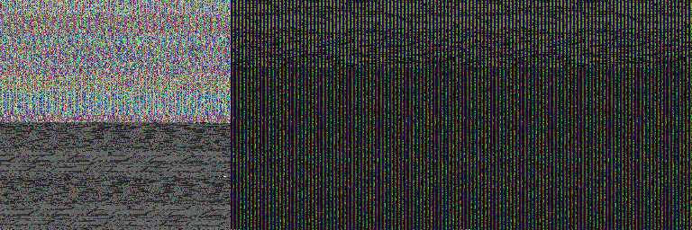
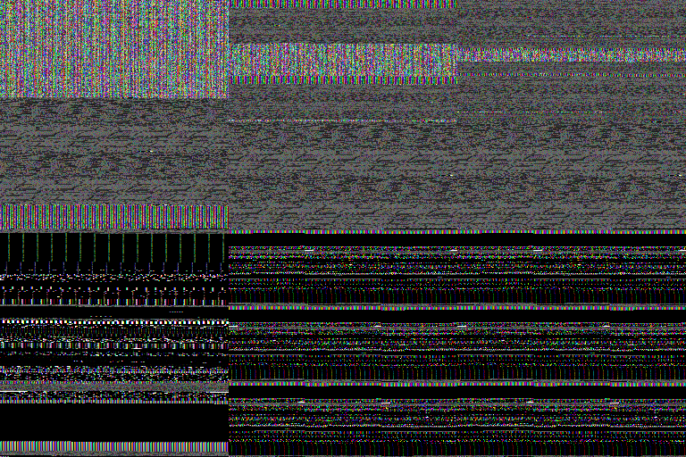
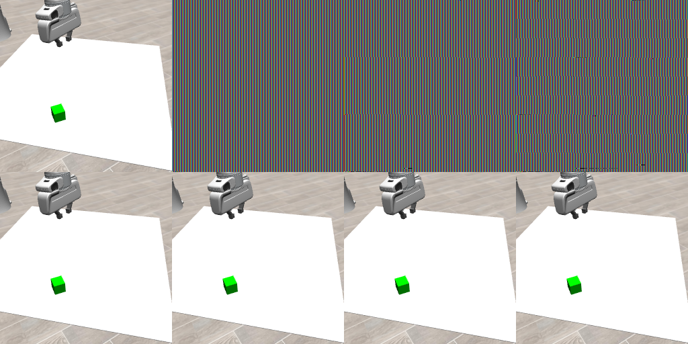
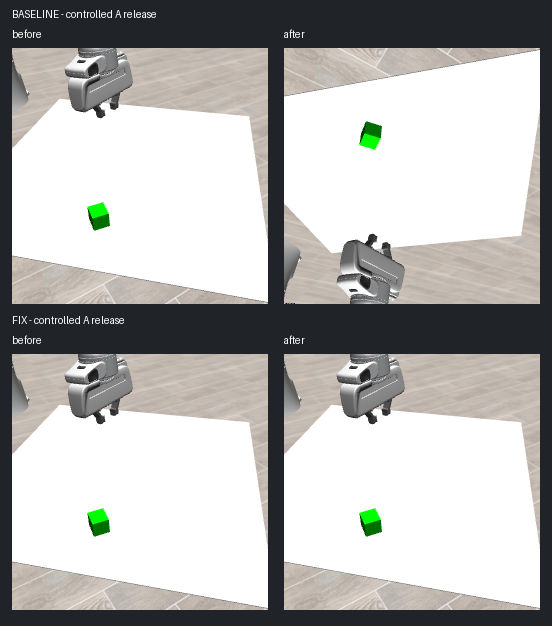

# KYC 基线失败：联合审查与故障定位报告

2026-11-02更新。**当前RGB故障已定位到错误context中的资源释放，并在相同受控释放点验证局部修复通过（LOCAL_CONTROLLED_PASS）。** Codex独立核对原数组、代码、图像、进程与预算，真实DeepSeek独立审查并交叉反驳。修复只在隔离harness中验证，未部署到旧环境；旧准确外参0/32的历史原因仍UNKNOWN，整体分类仍为D / IMPLEMENTATION-LIMITED。当前不建议完整重训或F算法开发。以下八部分已完成本轮交付，公开状态以[STATUS](STATUS.md)及[发布回执](orchestration/publication.json)为准。

## 第一部分：原始问题

上一轮冻结ACT完成20001 epochs、60003更新，200条训练示教、10条验证示教，专家动作回放10/10；策略在32个准确外参开发root中success/reach/grasp均为0。另有1条同root重复，不增加独立样本量。该基线没有任务阳性，因而无法把持续标定误差与IID误差的下游差异解释为鲁棒性问题；正式350条test对比从未运行。[旧联合报告](../research_expansion_20261029/02_联合研究最终报告.md)、[旧动作审计](../research_expansion_20261029/reproduction/results/offline_action_audit.json)。

这不等于KYC论文被证伪，也不等于所有相机鲁棒性问题不存在。本轮依照[原始任务书](00_原始任务书.md)区分H1入口不等价、H2动作后验损失与部署能力脱节、H3视角泛化、H4采样/仿真/历史渲染偏差。先恢复可解释的基线，再讨论研究创新。

## 第二部分：Codex独立审查

初稿在读取DeepSeek09前冻结；完整八项代码位置、支持/反对证据与最小检查见[独立审查](notes/01_Codex独立审查.md)。用户指定11文件与GitHub起点a03f16d逐blob一致，19项关键官方KYC源码核验一致；执行者后续扩展至48项官方源码/配置/camera blob。[来源核验](artifacts/github_evidence_verification.json)、[官方源码核验](artifacts/official_kyc_source_verification.json)。

| 检查 | 代码事实与判断 |
|---|---|
| 训练/部署入口 | 官方Dataset/ACT被复用；flip、/255、Plücker、token和动作还原关键路径同构。但同输入端到端数值等价此前未证明 |
| ACT后验/先验 | 提供actions时，即使eval模式也走动作条件CVAE后验；部署latent=0。验证loss含padding分母，不能等同有效步部署误差。小KL既不能证明也不能排除能力缺口 |
| 归一化 | drop1先将原始qpos置零再归一化，结果为−mean/std。不是归一化后零。新CPU重算四组stats与checkpoint/JSON逐维bit equal |
| 几何与RGB | 原反投影只证解析自一致；实际cam2world一致也不能代替可见表面与像素独立对应。共同crop保持RGB/ray一起处理 |
| 采样/恢复 | 20001轮均覆盖200demo，70/70/60批次，60003更新连续，恢复36→37。独立generator与官方全局RNG不同，训练内eval关闭；无逐步随机时刻/crop/camera记录，不能重建全部历史输入 |
| checkpoint | SHA一致、375 tensor条目有限、保存optimizer step为60003。新阶段没有创建ACT，架构strict load实际NOT_RUN；元信息合格不能替代加载/推理验证 |
| 环境/渲染 | 数据env_version与当前源码版本不同，无逐demo XML或存储RGB；旧训练缺官方framebuffer检查。均是差异或缺证据，未成为历史失败根因 |
| 动作异常 | 首步xyz跨root标准差约6.86e−5、2.58e−5、1.23e−4米；目标z增量平均约−5.59e−4米。支持该开发条件动作集中，不证明训练条件同样无效；增量累计不是实际EEF位移 |

不为技术原因编造可信度排序。最值得直接查的是固定输入等价、同样本prior/posterior与强常数对照；当前新增坏图又把渲染健康性提前为模型诊断的必要前提。

## 第三部分：DeepSeek独立审查

通过本机已配置Claude终端客户端真实调用，接续会话736077c1-8d4e-4df7-979f-1fc15f980a2a，响应模型字段deepseek-flash。09至25共十七轮成功调用的prompt/response/metadata均保存；不是由Codex模拟另一模型。CLI用量字段可能累计且costBasis未知，不据此宣称实际账单。[会话核验](artifacts/deepseek_rounds_verified.json)。

[09独立意见](discussion/09_diag_independent_response.md)提出区分后验拟合、部署先验与相机分布。它也包含错误，不能当最终结论直接采纳：qpos、官方早期eval数量、posterior调用预算、CamVLA消融位置均在后续纠正。[13执行后独立验收](discussion/13_diag_acceptance_independent_response.md)接受受控停止，但其“最可能诊断/上下文问题”排序在14中撤回；没有机制对照就不能排序。

定向一手证据包括[官方固定源码](https://github.com/ripl/CamPoseOpensource/tree/e0647105a0f3946581d253c55dc9fd1218fa0974)、[作者framebuffer说明](https://github.com/ripl/CamPoseOpensource/issues/1#issuecomment-3533166490)、[作者test camera说明](https://github.com/ripl/CamPoseOpensource/issues/2#issuecomment-3598554639)。[PR5](https://github.com/ripl/CamPoseOpensource/pull/5)是未合并的兼容建议，本机MuJoCo3.3.0已处建议区间，不构成自动升级理由。此次查询仓库/releases/issues未找到匹配LiftRand/eef_delta/ACT的训练完成策略checkpoint；“未找到”不等于全网不存在。

研究竞争边界沿用上一轮核验：[KYC](https://arxiv.org/abs/2510.02268)已有几何条件化，[CamVLA](https://arxiv.org/abs/2607.05396)已有逐query外参噪声分析，[AnyCamVLA](https://arxiv.org/abs/2603.05868)已有视角适配。persistent与IID的窄对照不自动成为可发表创新，普通重标定、pose jitter等简单方法仍须比较。排障本身不包装为论文贡献。

## 第四部分：真实交叉讨论

| 轮次 | 实质争议与变化 |
|---|---|
| 09→10 | Codex纠正qpos含义、0reach不能排除严重视角OOD、Lift YAML覆盖eval阈值10000、CamVLA消融应看Figure5；DeepSeek承认修正 |
| 10→11 | 不接受“posterior必须优于prior”作为健康门槛；healthy prior可接近posterior。所有重复均计预算，双方要求两入口噪声估计、30×7按训练采样加权常数、同单位和明确停止伪代码 |
| 11→12 | 条件通过不算执行授权；v2落实修改后DeepSeek12明确APPROVE，冻结准确SHA，再派发 |
| 13→14 | Codex独立重算原数组/PNG、查看图像、核对代码后反驳未经证据的原因排序；DeepSeek撤回排序。flip后接近不能判flip错误，PNG/float保存不是同等未检解释 |
| 用户新增指示→15 | 用户要求继续查因并解决当前RGB问题；另立12render微诊断。DeepSeek15要求日志不持有对象、独立OS进程、sentinel与正常读图分离、完整锁区修复及隐式调用计数；v2/v3进一步明确锁与sentinel实现，17最终APPROVE，17:17:25已派发 |
| 18→19 | Codex先独立验收失败输出；DeepSeek18的事件索引偏1和“con.free更可能”排序在19撤回。0x8219只测当前draw绑定，不能据此证明offFBO误删除；单纯重绑已失败，另拟所有权安全释放候选 |
| 19→20 | DeepSeek要求owner=current才能测owner资源；v2落实baseline仅测current活动renderer、fix在con.free前后且EGL销毁前测owner、恢复后测previous。20于11月2日完整APPROVE后冻结SHA并派发 |
| 21→22 | 结果虽有健康图，fix拍图期没有释放旧owner；双方拒绝据此确认完整修复。父审CPU复现unknown非空context被误当NULL，另拟受控同点释放；不能把候选代码安装的时序效应与所有权释放机制混为一谈 |
| 23→25 | 双方分别核验受控结果，接受局部PASS；纠正DeepSeek的fix与baseline事件编号。下一草稿补双入口重复、窄化小样本投入结论和无GPU等待；自然窗口未出现须NOT_REPRODUCED，不能冒称自然修复或旧0/32因果。完整意见保留在23–25原文 |

完整对话与联合优先级表见[讨论记录](notes/02_交叉讨论与联合优先级.md)。两模型同意不等于因果证明；独立仅指先形成各自本轮意见，再交换，不声称统计独立。

## 第五部分：GPT-6.1-sol/max的真实任务与执行

原任务11:59:36实际派发至线程01a185d0-2da8-70a2-b997-d273c7285042，标题“**KYC 冻结基线有限排障与验收回传**”，指定gpt-6.1-sol/max。[派发](orchestration/dispatch.json)、[双方过门](orchestration/review_gate.json)、[完整协议v2](01_有限排障执行任务书.md)。协议SHA256为ae04cd358b7e7faa24110dbb447973e518aa739830e541e6bb5dab5c0a7c97ea。

Stage0只读报告先于Stage1落盘。Stage1 GPU worker于12:12:58.614启动，12:13:10.194正常按停止门退出；exit0表示受控结束，不表示所有诊断通过。执行者12:26一次性回传并释放Git index，自己的定时检查已暂停。[命令](execution/commands.jsonl)、[阶段0](execution/stages/stage0.json)、[阶段1](execution/stages/stage1.json)、[回传回执](orchestration/executor_return_receipt.json)。

| 项目 | 实际 | 冻结上限或状态 |
|---|---:|---|
| 固定ACT前向 | 0 | 32；在创建ACT之前返回 |
| 闭环query / rollout / env.step | 0 /0 /0 | 80 /16 /2400；任务成功率null+NOT_RUN |
| 优化器更新 | 0 | 上限0 |
| 输入来源状态 / demo | 8 /4 | 不是8个独立任务 |
| 显式RGB render / make_env | 24 /1 | 三入口分别渲染；无额外smoke |
| GPU分配墙钟 | 11.579576秒 | 3600秒，计整个worker生命周期 |
| 新模型/数据/包下载 | 0 | 禁止安装与系统更改 |

原Stage1B、C、正式test均NOT_RUN。之后按用户“有问题就检查并尝试解决”新增三个独立修复协议，每次均在双方审核后实际派发至同一gpt-6.1-sol/max线程；没有复用旧supervisor或原模型预算。

| 后续独立范围 | 实际worker / render / readPixels | 累计GPU分配秒 | 验收 |
|---|---:|---:|---|
| render_repair | 2名额、仅1有效 /6 /12 | 23.1327807279 | 单纯重绑失败，独立复验NOT_RUN |
| render_lifecycle | 2 /8 /16 | 24.4112538821 | 当前误释放机制成立；修复因果PARTIAL |
| render_controlled | 2 /4 /8 | 19.2856587232 | 固定fixture下LOCAL_CONTROLLED_PASS |

三项ACT、env.step、rollout、优化器更新全部0。最新受控协议SHA为`0b39318295a299d9fc55327af7b24925b58036563819368154e39911f235fd8e`，14:25:10真实派发，GPU worker于14:46:47–14:47:06顺序执行并退出，15:02一次回传；180GPU秒与22:25:10截止均未超限。[实际派发](render_controlled/dispatch.json)、[执行计数](render_controlled/counts.json)、[回传](render_controlled/return_receipt.json)。

## 第六部分：结果与独立验收

8组固定输入的state、qpos、token、Plücker六通道等数值一致，实际相机矩阵误差最大约2.22e−16；RGB均不完全一致。代表样本0/4明显高频彩色噪点与条纹，不能辨认正常Lift。主审实际看了这两组拼图和旧dev1000初始图，未冒称逐图看完另外6个样本。[执行原始报告](execution/FINAL_REPORT.md)。

| sample | demo/t/camera | Dataset–Evaluator不同像素（总65536） | RGB平均绝对差，0–255单位 |
|---|---|---:|---:|
| 0 | 0/0/1 | 65532 | 84.2766 |
| 1 | 50/0/51 | 65530 | 81.7468 |
| 2 | 100/0/101 | 9 | 0.0141 |
| 3 | 150/0/151 | 65532 | 77.1344 |
| 4 | 0/52/1 | 65531 | 77.1319 |
| 5 | 50/48/51 | 7 | 0.0099 |
| 6 | 100/58/101 | 7 | 0.0105 |
| 7 | 150/46/151 | 65298 | 52.3022 |

相近坏图不等于健康图。由于三入口分别渲染，**共同raw RGB前提失败，不能据此把预处理判为根因**。原代码stage1.py:370–379在输入门失败后返回，早于ACTPolicy创建；没有prior/posterior数组或闭环轨迹，不能计算P/M/Q、常数地板或训练相机成功率。

Codex独立CPU复核176数组与8NPZ哈希，PNG反解逐像素等于保存tensor；重算20400训练帧stats、30个chunk位置的7维加权median/mean；检查6615旧文件大小/mtime/SHA均未变，冻结代码未变，原进程已退出。GPU起止时间差11.579582秒与单调时钟记录相符。[数组/进程核验](artifacts/parent_execution_audit.json)、[stats/常数核验](artifacts/parent_stats_constants_audit.json)、[验收意见](notes/03_Codex执行结果独立验收.md)。软件计数、代码分支与文件缺失互相印证，不冒称硬件逐调用追踪。

执行记录曾误把archive内vendor的Git版本读成父仓库HEAD，以及简写HDF5 schema；原件保留并有[来源纠正](execution/results/version_provenance_correction.json)、[schema澄清](execution/results/schema_clarification.json)，没有静默抹去错误。

首次绑定修复现已完成，结论为 **PARTIAL / REPAIR_FAILED**。worker1因本轮NULL opaque pointer取址错误在实际make_env之前失败；一次工程修正后仅worker2有效，未重启原terminal supervisor，进程名额与累计时间未回收。实际6renders、12readPixels、23.1327807279 GPU秒、0ACT/step/更新；“两有效进程独立复验”为NOT_RUN。Codex已独立重算6帧raw→flip→tensor→NPZ/PNG全链、12原始数组哈希、76旧文件和源码/恢复代码哈希，全部对应；六张图实际查看后均仍为条纹/噪点。不是仅PNG保存造成损坏。[独立验收](notes/04_Codex渲染修复独立验收.md)、[CPU核验](artifacts/parent_render_repair_audit.json)、[执行原件](render_repair/FINAL_REPORT.md)。

原始事件零基索引23/24时新ctx2为current，25旧ctx1释放入口仍为ctx2；28→29同一eglReleaseThread调用将ctx2解除为null。这是当前插桩进程中的直接绑定丢失链。单次make_current恢复ctx2后仍有render 1286/readback 1282错误，sentinel165全部保留且正常图仍坏，证明该绑定候选未修好。它不等于证明所有历史训练输入损坏。

**仅在首项绑定实验中，FBO误删除当时未证明。** 原遥测只查询当前draw绑定，未记录绑定对象身份；默认FBO0在surfaceless环境中可以返回0x8219。MuJoCo的con.free确实释放GL资源，但它是否在错误context中删除了当前renderer资源，需要con.free前后对象身份和有效性证据。[Khronos状态查询定义](https://raw.githubusercontent.com/KhronosGroup/OpenGL-Refpages/main/gl4/glCheckFramebufferStatus.xml)、[MuJoCo3.3.0资源释放源码](https://raw.githubusercontent.com/google-deepmind/mujoco/3.3.0/src/render/render_context.c)。后续协议据此验证“按所属context释放并恢复previous”，不叠加buffer重建/驱动修改。每种条件只有一个worker，成功也只能支持固定样本/构造顺序的局部修复。

历史训练RGB/GL缺失，旧dev代表图清晰；当前坏图及当前机制不能追认为旧0/32根因。后两项新增证据如下，旧记录不追补。

先前原执行、绑定修复和生命周期结果均已公开；曾遇HTTPS408的失败回执保留，不代表当前发布状态。最新分支为`research/u-gate0-v3-overnight`，每批使用明确允许清单和原始/解码内容扫描，提交内SHA与远端独立核验。最新验收与受控原件的提交见[发布记录](orchestration/publication.json)，未上传权重、环境、凭据、完整XML或raw CLI。

新的render_lifecycle已实际完成并经父审独立核验。2worker、8renders、16readPixels、24.4112538821GPU秒，0ACT/step/训练，180旧文件及冻结代码未变。实际查看八图拼图：baseline early正常、后三帧条纹；fix四帧清晰且与baseline early逐像素相同。40链路边界、8共同预处理、16raw哈希由主审独立重算。[父审](notes/05_Codex生命周期结果独立验收.md)、[CPU原件核验](artifacts/parent_render_lifecycle_audit.json)、[执行报告](render_lifecycle/FINAL_REPORT.md)。

**当前基线的资源错误释放机制现在有直接证据。** 零基事件29→30中owner=ctx1、实际current=ctx2，查询的是ctx2活动renderer的真实对象，3个FBO和4个RBO在同一次con.free前后由glIs=true变false；ctx1对象始终NOT_MEASURED_WRONG_CONTEXT。34→35再解除ctx2。因此前述“仅0x8219不能判资源被删”的缺项，在这一个新插桩基线进程中已补齐；不能反向补写旧进程原本没有的日志。

**该次生命周期结果没有完成修复因果验收。** fix最后采图事件56，而目标释放只在cleanup的59/75出现；真实previous_restored=0。健康图没有经历目标跨context故障，不能归因于owner绑定/恢复previous机制；它只说明该次采图期间图像健康。自然GC/分配时序未单独辨识，不对成因排序，也不排除不同代码安装本身影响时序。执行COMPLETE，因果验收PARTIAL。

父审另用纯CPU复现候选的边界漏洞：原始current非零但registry key=None时，会按NULL previous处理并返回DONE；原20个mock的unknown字符串没有覆盖这个真实适配器形态。该分支不在本轮实GL证据中，不是坏图已证原因。受控候选已在任何绑定/释放前拒绝未知非空context，并将前置异常可见化；父审纯CPU反例复验通过。

最新的**render_controlled补齐了相同触发与真实恢复证据，LOCAL_CONTROLLED_PASS**。两条件都固定sample0，强持有退休renderer A与活动renderer B，在健康before后、同一原锁内显式一次释放A；fixture两条件一致。baseline零基31→32：owner=A/current=B，B原3FBO+4RBO同ID由有效变无效，A正确记NOT_MEASURED_WRONG_CONTEXT；37→38解除current。fix33→34在owner A当前时正确释放A资源；46原生恢复返回true、47恢复活B、52确认A已销毁且B原对象全部有效；53–60采图没有额外重绑/重建。fix after与before及冻结健康参考逐像素相同，正常readback=sentinel、观测GL读回codes=[0]。

baseline after虽然外观看起来仍像场景，sentinel却100%保留165、无current，不能当成有效新读回；其54.22%通道值改变且不是before的精确垂直翻转，具体内存来源UNKNOWN。修复不能只凭清晰截图判定。

Codex重新核验4帧×5转换边界全部精确、8次raw数组文件/内容SHA、state/T/XML一致、295旧文件size/mtime/SHA与冻结脚本/来源哈希不变；确认两worker及监督器退出。每个renderer首次con.free与成功context destroy各一次，DONE guard只防重复释放，cleanup全部context销毁、fixture引用0。无泄漏资源换取健康图。启动前全设备显存监控修订在workers=0时重新冻结，没有GPU执行后修改代码。[主审独立意见](notes/06_Codex受控修复独立验收.md)、[CPU验收原件](artifacts/parent_render_controlled_audit.json)、[执行报告](render_controlled/FINAL_REPORT.md)、[真实DeepSeek独立意见](discussion/23_controlled_independent_response.md)。

可复用的隔离候选见[释放事务](render_controlled/scripts/owned_release.py)及[实际适配/guard集成](render_controlled/scripts/worker.py)。它把owner绑定→原资源释放→原EGL释放→恢复仍活previous作为整体事务，并在未知非空context时前置拒绝。它不是可未经审核直接注入任意工程的补丁；旧源码未修改。

**边界必须保留：**一个固定状态、每条件一个进程、人为共同fixture和确定性释放点；未分离owner释放与previous恢复各自贡献，未证明自然GC频率、多视角、长期/线程安全，未复验原三入口。原20个CPU mock遗漏的unknown形态现已纳入30项软件检查，但实际GL没有触发unknown分支。当前局部PASS不补全旧训练RGB/GL历史，不解释旧0/32，更不是论文创新。

## 第七部分：投入决策与五个直接回答

旧基线整体为**D / IMPLEMENTATION-LIMITED**：不是A（旧失败因果未定位）、B（无训练相机任务阳性）、C（没有训练条件闭环证据）。本轮当前RGB子问题有明确局部工程原因与修复证据；原模型诊断未跑阶段依然NOT_RUN。

| 问题 | 当前答案 |
|---|---|
| 1. 旧KYC基线失败原因已定位？ | 否。当前错误context释放机制已证，旧训练是否发生相同窗口未知；H1模型数值、H2部署先验与H3相机闭环未测 |
| 2. 有明确低成本修复？ | 有局部验证通过的owner释放与previous恢复事务。19.29 GPU秒受控验证，原对象保留、真实恢复和像素一致均通过；尚未验证自然入口整合或普遍部署 |
| 3. 值得新一轮完整训练？ | 目前不建议。先判断现有冻结权重是否还有可恢复的训练样本生成能力；完整训练仍须人类明确批准 |
| 4. F值得作为当前硕士论文候选？ | 暂未合格。修复输入只是诊断前提，缺任务阳性、可重复的剩余缺陷与简单基线对比；这是当前资格不足，不是领域科学No-Go |
| 5. 后续替代系统优先什么？ | 优先已有可访问且匹配的官方policy checkpoint、任务/数据、动作语义、环境版本和任务阳性；这只是选型标准，本轮不另开复现或新下载 |

本轮没有以增加epoch、seed或模型掩盖故障，也没有声称“两个模型都同意”构成因果证据。继续投入的优先项是已有权重的小规模诊断，不是昂贵完整重训或F方法开发。

## 第八部分：下一阶段完整任务与本轮结束

已给出可完整复制的[下一阶段提示词：健康输入下的冻结checkpoint诊断](03_下一阶段提示词_冻结模型诊断待批准.md)。仅为研究负责人审阅稿，**未派发、未获新的执行授权**；原任务书明确“生成任务书不等于自动获得执行授权”。旧三个修复scope全部终止，不重启、不合并剩余额度。

候选上限16次batch1前向、12render/24readPixels、2worker/2make_env、600GPU秒，0step/rollout/训练；固定4状态仅来自2demo。采用同份健康raw比较官方/自定义prior，含两入口重复和明确动作条件posterior，比较训练采样加权常数。先输入制备worker退出，主审看图/CPU门，再模型worker；等待期间无GPU作业。最终真实入口集成、代码SHA、阈值和停止门仍须双方审定，不能凭本稿执行。

若自然目标释放窗口没出现，记录NOT_REPRODUCED，不能声称自然修复；当前输入通过健康门后的模型诊断仍只回答权重数值问题。小样本不胜常数最多影响当前checkpoint/当前范围的机会成本判断；优于常数也不是Lift任务阳性，不自动rollout或训练。

公开交付现已完成，主automation与子6-1-sol-max均已暂停并读回核验；实际状态见[检查记录](orchestration/clocks.json)。完成前仍保留原最长五小时兜底及共享额度reset+120秒策略，完成回传已提前唤醒主审，没有空等或兑换重置券。以后只有新的明确授权和实际派发才复用检查，不留下无任务的反复唤醒。
