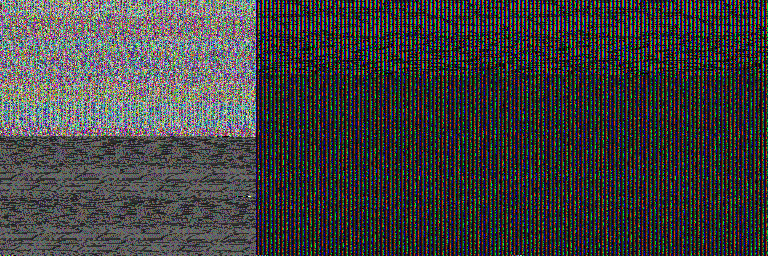
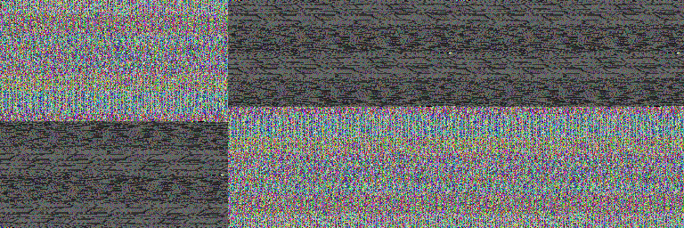

# KYC 冻结基线有限排障：执行报告

**受控提前停止，完整度 PARTIAL，建议验收边界 D / IMPLEMENTATION-LIMITED。** Stage0 未发现足以解释旧 0/32 的明确问题；Stage1A 的当前 RGB 渲染前提失败，因而模型前向、posterior/prior 比较和相机闭环均为 **NOT_RUN**。不是 C 类“训练条件下普遍无任务能力”，也没有证明旧训练受到相同渲染故障影响。

执行线程 `01a185d0-2da8-70a2-b997-d273c7285042`，按 GPT-6.1-sol / max 派发；Codex 与真实 DeepSeek 负责独立验收和最终研究判断。本报告只交付实际执行与证据。冻结协议 SHA256 `ae04cd358b7e7faa24110dbb447973e518aa739830e541e6bb5dab5c0a7c97ea`，未改动。

## 1. 核心新观察

对固定 demos 0/50/100/150 的首帧和中点，共8个来源状态，使用同一环境、同一 float32 source state 和对应训练相机，分别取官方 Dataset/id、官方 Evaluator helper、自定义 helper 的输入。物理 state、qpos、相机 token、Plücker 六通道、normalized action/mask、固定共同 crop 在所查比较中均 bit equal；实际 MuJoCo 相机矩阵与给定 T 的最大误差约 2.22e-16。

**RGB 不满足逐像素一致性。** 更关键的是，代表样本0和4的原件直接显示彩色高频像素损坏，无法辨认正常 Lift 场景。下图从保存的张量重建，没有重新渲染；依次为 Dataset/id、官方 Evaluator、自定义入口。

| sample | demo / t / camera | Dataset–Evaluator 不同像素 /65536 | uint8 RGB mean abs | Dataset–custom mean abs |
|---|---|---:|---:|---:|
| 0 | 0 / 0 / 1 | 65532 | 84.2766 | 84.2771 |
| 1 | 50 / 0 / 51 | 65530 | 81.7468 | 106.0618 |
| 2 | 100 / 0 / 101 | 9 | 0.0141 | 0.0092 |
| 3 | 150 / 0 / 151 | 65532 | 77.1344 | 0.0141 |
| 4 | 0 / 52 / 1 | 65531 | 77.1319 | 77.1252 |
| 5 | 50 / 48 / 51 | 7 | 0.0099 | 0.0111 |
| 6 | 100 / 58 / 101 | 7 | 0.0105 | 0.0114 |
| 7 | 150 / 46 / 151 | 65298 | 52.3022 | 0.0203 |

小 mean abs 只表示两张受损图像相近，不能当渲染健康。部分差异经上下翻转接近，且存在少数大值像素；这些是保存数组的描述，不证明翻转代码、GPU驱动或某个 framebuffer 机制是根因。全部8份 NPZ、源张量 hash、逐项比较和 RNG 恢复断言见 [input_comparisons.json](results/input_comparisons.json)、[render_audit.json](results/render_audit.json) 与 inputs/。只有样本0/4的代表拼图作了视觉检查，其余6个样本的结论来自数值比较，不冒称逐图看过。

本次先分别渲染再比较，原始 RGB 已不同，故**同 raw RGB 的预处理与模型数值等价比较前提没有成立**。不能把这些差异直接写成 H1 的适配预处理错误。该阶段应解释为渲染前提检查失败；没有在无效输入上执行剩余前向。保存输出的 `state=COMPLETE` 表示8份输入采集完成，不代表 Stage1A/B/C 全部完成。

没有在本次短作业中采集 GL framebuffer status、GL error 或 context 生命周期；不能将当前像素损坏命名为已确认的 framebuffer leak。源码事实和 [作者 issue1](https://github.com/ripl/CamPoseOpensource/issues/1#issuecomment-3533166490) 只提供可能机制。已有旧 expert/dev 代表 PNG 可辨认正常场景，旧训练批次 RGB/GL 状态缺失。因此当前异常不能追溯为旧训练 0/32 的已证明原因。

## 2. Stage0 得到和没有得到什么

[Stage0 报告](stage0_report.md) 在任何本轮环境/CUDA/模型调用前已落盘，门槛为 NEEDS_BOUNDED_STAGE1，双方已批准的任务书允许继续。

- checkpoint 845,671,886 bytes，SHA `c904a97002571d96e3ee6b66057d09162cbdcb5e926cb6ea0b660ca1390bce13`；375 个 tensor entries 全有限，60003 updates /20001 epochs，args 与 C_config 相同，保存的 optimizer step 均为60003。没有实例化策略或加载 optimizer；因A停下，本轮架构 strict load 为 NOT_RUN。
- 前200训练 demo 共20400帧，按官方 float32 ACT 公式重算 stats，checkpoint/JSON 四组逐维 bit equal；动作逆归一化最大 roundtrip 误差约1.49e-8。drop1 qpos 为 −mean/std，cam token 为零。
- 60003条训练日志连续；20001轮每轮覆盖demo0–199一次，batch70/70/60；恢复36→37连续。历史随机时刻、crop、camera和framebuffer未记录，不能从seed冒称重建。
- 旧32 roots+1重复共4950步的动作异常得到独立重算；目标增量和不是实测EEF位移。专家10/10只约束明显整体wrapper错误，不证明学习策略或视觉训练健康。
- 独立核对旧11文件与 Git 起点一致；48个官方源码/配置/相机 blob 一致。vendor由archive解压、没有自己的.git，初次version字段误取父仓库HEAD，已用独立blob证据纠正且保留原件。HDF5 schema简写也已补充准确字段；这两项记录修正不增加模型/渲染调用，也不改变阶段门槛。
- env_version1.4.1与源码1.5.1、缺demo XML/RGB、sampler RNG、关闭训练内eval、val相机改变、缺官方framebuffer检查均保留为差异或未知；没有从源码差异直接推因果。本地MuJoCo3.3.0符合未合并PR5的建议区间。

前200 demo 的30×7位置加权 median/mean、弱单向量常数和physical zero已在模型前冻结于 [constants.json](constants.json)。权重、tie规则、有效项数和每位置质量完整保存。**没有取得 prior/posterior 误差，因此 open-loop 地板没有计算或触发。**

## 3. 实际计数与资源

| 项目 | 实际 | 冻结上限 / 含义 |
|---|---:|---|
| 固定 ACT 前向尝试 | **0** | ≤32，失败/重复/调试均计；本次在创建ACT之前停止 |
| 闭环 query | **0** | ≤80；闭环为 NOT_RUN |
| rollout / env.step | **0 / 0** | ≤16 /2400；success/n均null+NOT_RUN，不能写0/8 |
| 优化器更新 | **0** | 上限0；无backward、step、重训 |
| 来源状态 / 独立demo | **8 /4** | 非8独立任务，无任务成功率估计 |
| 显式RGB render请求 | **24** | 每状态三入口；1次make_env，无额外smoke |
| GPU分配墙钟 | **11.579576秒** | ≤3600；保守计入整个GPU worker生命周期，含导入/准备/渲染/退出 |
| 新增数据/模型/包下载 | **0** | 只查询小型公开源码/元数据；无安装、环境修改 |

GPU worker 2026-10-29 **12:12:58.614–12:13:10.194 Asia/Shanghai**，exit0，表示按输入停止门正常结束。Stage0 worker 12:05:09.959–12:05:16.126，exit0、CUDA未初始化。原始命令、PID/start_ticks、SID、退出码见 [阶段0](stages/stage0.json)、[阶段1](stages/stage1.json)、[commands.jsonl](commands.jsonl)。独立supervisor与提交者不同SID，flock防重启、调用前持久计数、3590秒终止加释放余量、内存/磁盘/截止门及自动completion已提前实现；本轮未实际触发预算中断，不声称已实测硬终止路径。

10秒资源采样中 Stage1 进程树RSS最大约1.394GiB、自有GPU内存384MiB；这些是采样值，不是连续峰值保证。新产物约50MB，低于2GiB。结束后自己的worker/supervisor均已退出，GPU仅保留开始前已存在的用户进程，未终止他人作业。没有模型创建，torch模型allocator峰值为NOT_RUN。机器初态与完整CLI仅留local_only/logs，不公开。

## 4. 完整度和决定边界

| 工作 | 状态 |
|---|---|
| Stage0只读审计、样本/常数/预算冻结 | COMPLETE |
| Stage1A八来源输入与渲染前提检查 | 输入采集COMPLETE；前提FAILED；整个A为PARTIAL |
| 同raw RGB的入口模型输出、两入口重复噪声 | NOT_RUN |
| Stage1B posterior/prior/常数误差及地板 | NOT_RUN；P/M/Q为null |
| 独立可见几何/像素投影 | NOT_COMPLETED；实际相机矩阵比较不能替代它 |
| Stage1C 8旧roots×2相机闭环 | NOT_RUN；不能当16独立roots或C类任务阴性 |
| 正式test、新算法、完整训练 | NOT_RUN / 未授权 |

建议验收采用 **D/IMPLEMENTATION-LIMITED**：已有可复核的当前视觉输入故障，旧基线失败的历史根因仍未定位。H2/H3没有新增任务证据。当前不支持投入完整ACT重训，不支持把F升级为新方法研发；也不构成KYC或相机鲁棒性科学No-Go。

Stage2只供研究者考虑：若继续，先另行审查一次更窄的渲染来源/GL context诊断，分别记录framebuffer/error/context和同raw像素，不改变模型、数据、驱动或旧代码；只有得到健康且可重复的输入，才考虑新的前向授权。当前没有已验证的具体修复或足以支持重训的因果证据，本轮未执行修复、重试、追加实验或下一阶段。

## 5. 交付和恢复限制

查看 [run_manifest.json](run_manifest.json)、[budget.json](budget.json)、[sample_plan.json](sample_plan.json)、[root_plan.json](root_plan.json)、[counts.json](counts.json)、[completion.json](completion.json) 和 [delivery_integrity.json](delivery_integrity.json)。旧目录6615个受检文件的大小、mtime、hash均保持不变；完整checkpoint/资产和协议SHA再次核验。

完整运行命令已执行完毕。**不要重启supervisor或复用剩余预算。** 新诊断需Codex/DeepSeek验收后另立范围；完整训练还需人类明确批准。只读复核可运行 `scripts/analyze_render.py` 和 `scripts/verify_delivery.py`，它们不初始化环境/CUDA、不产生新观测。

公开同步仅逐路径包含本次原创脚本、清单、报告及必要小型NPZ/PNG/JSON；不含runtime、第三方源码镜像、weights、HDF5全量数据、完整XML、缓存、凭据或raw CLI。真实提交与remote SHA见交付后的publication.json/回传回执。主研究者后续进行Codex独立核验、真实DeepSeek反驳及最终人类报告。
