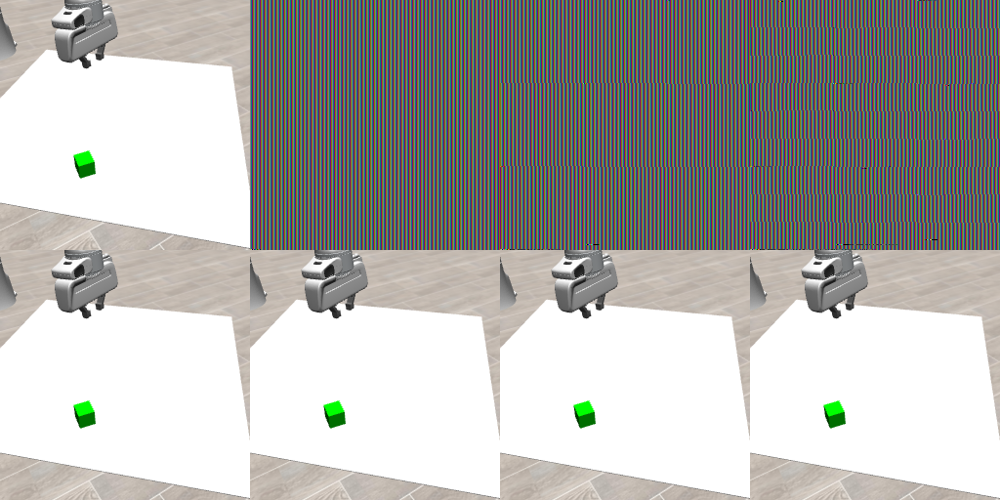

# 当前RGB生命周期诊断：执行完成，修复因果验收 PARTIAL

**基线记录到错误context中的con.free使活动renderer资源失效；修复条件图像健康，但关键故障窗口没有在修复进程中重现，不能宣称完整修复PASS。** 旧训练0/32历史因果仍为UNKNOWN。本轮全部GPU作业已结束，未启动ACT、env.step、rollout或训练。

冻结协议v2 SHA256 `53b7058bd290886d5787cd73ed9cb926a38ec49792a99305a84db11a1c3d8d0f`，双方APPROVE。派发2026-11-02 09:27:56.482676 Asia/Shanghai，8小时截止17:27:56.482676。当前工作仅在render_lifecycle；旧terminal作业未重启，Git index始终归主线程。

## 1. 结果与关键反证

我实际查看这张8图拼图：基线early能辨认机械臂、白桌面、绿色目标，随后三个入口变为条纹；fix四图均能辨认同一正常场景。CPU核对fix四张PNG **逐像素相同**，且与baseline early也逐像素相同。8帧state/T/XML hash均一致。raw→flip前后→float→NPZ/PNG共40项边界关系全部精确；共同raw RGB三种纯预处理8组也精确相同。

| 条件 | early | Dataset / Evaluator / custom | sentinel与同帧preflip raw | current与真实readback |
|---|---|---|---|---|
| baseline，worker1 | 健康 | 三帧条纹损坏 | early完全相同；后三帧不相同，165全保留 | early ctx2且GL error序列[0]；后三帧无current，GL查询跳过 |
| fix，worker2 | 健康 | 三帧健康且四图bit equal | 四帧均与raw完全相同、maxabs0 | 四帧ctx2，正常readPixels前后error均[0]且排空 |

健康图像中165像素比例约0.001296997；这部分是实际场景像素，不能把任何sentinel颜色残留都当失败。sentinel是独立数组，从未进入正常流水线；8个额外readback均在原渲染锁内完成，不改正常np.empty或RGB。基线early提供了实际健康读回对照。

**关键限制：fix的旧ctx1直到最终CLEANUP才析构。** 四张健康图像完成之前没有任何 `owner_bound_before_con_free` 事件。其ctx2先在cleanup释放，然后ctx1才在无previous current时释放。因此：

- 不能把fix图像健康归因为修复已在相同跨context故障窗口执行；该因果关系未建立。
- 真实GL中没有 `previous_restored` 事件，也没有恢复“另一个仍活context”的实际调用；这个分支仅经CPU mock验证。
- fix确实在owner当前时分别释放了ctx2与ctx1的资源，但均在cleanup、previous分别为owner或null。它没有提供“释放旧owner后恢复活previous并保持其对象有效”的完整对照。
- 自然GC/分配/日志导致的时序差异没有被单独辨识；本轮未主动GC、禁用GC或故意持有旧renderer。资源最终都释放，没有通过长期泄漏躲避清理。

因此本轮是 **实验流程COMPLETE、因果验收PARTIAL / LIVE_PREVIOUS_WINDOW_NOT_EXERCISED**。不把健康截图或CPU mock冒充完整GL修复证明。详见 [analysis.json](analysis.json) 的触发时点、对象窗口和未测字段。

## 2. 按context归属隔离的实际对象证据

baseline事件零基索引29→30，entry=CONSTRUCT_DATASET：

- 正在释放的owner为w1_ctx1，真实current在前后均为w1_ctx2。
- 旧owner的对象前后均明确 `NOT_MEASURED_WRONG_CONTEXT`，没有在ctx2查询ctx1的同名对象来填证据。
- 测量的是ctx2所属活动renderer的真实对象。其offFBO=1、offFBO_r=2、shadowFBO=3的glIsFramebuffer由true变false；offColor=1、offColor_r=3、offDepthStencil=2、offDepthStencil_r=4的glIsRenderbuffer也由true变false。对象前后namespace均为w1_ctx2，ID一致。
- 该窗口插在同一次原 `self.con.free()` 前后；随后原EGL free/release再解除current。**这是活动context资源失效的实际对象证据，不是仅凭0x8219或FBO整数相等推测。** 它仅描述该插桩基线进程。

fix事件59→60（ctx2）与75→76（ctx1）均在CLEANUP：owner=current，保存的primitive IDs在con.free前glIs为true、之后为false；测量发生于gl_ctx.free之前，归属正确。owner销毁后没有再查询其资源。因为没有活previous恢复窗口，这些证据只证明该条件的owner内清理路径，**没有补齐§6要求的previous对象保护对照**。

遥测记录真实draw/read framebuffer binding、已绑定非零FBO的status/attachments、合法owner内的FBO/RBO有效性和已绑定RBO尺寸。没有为了查询绑定FBO或context，没有假定不同context共享同名对象。默认FBO0单列不赋值给offFBO；非渲染检查点出现0或undefined本身不作失败门槛。查询会消费/可能引入error，错误码属于包括查询的区间；不把单一status或error排他归因于原操作。

## 3. 代码、mock和运行方式

[owned_release.py](scripts/owned_release.py) 是本次唯一候选事务：保存previous display/draw/read/context与生命周期身份；确认owner存活后绑定owner；释放同一con与原gl_ctx；仅恢复不同于已销毁owner且仍存活的previous；验证返回值/current，异常可见并停止。处理重复、重入、部分初始化，未知owner不得在错误context继续free。没有render-time make_current补救、buffer重建、驱动/环境改动或第二候选。

CPU mock **20/20通过**，覆盖NULL opaque取址、正常指针、部分/重复/重入清理、owner缺失/死亡、previous=owner/其他live/null/unknown、bind/con/EGL/restore失败、previous死亡、恢复display/surfaces/context、wrong-owner和stale-current查询禁止。mock只用Python/ctypes fake，不创建GL/CUDA/env；不能替代真实GL分支验证。

原与fix从各自全新Python进程初始化前安装。baseline析构逐句保持原释放顺序及原gl_ctx.free异常处理，只加con.free边界；原析构源码hash在各worker的destructor_source.json，原片段仅local_only。日志只存primitive/弱引用，context地址映射只在local_only。registry没有强持有renderer来改变生命周期；日志和独立数组复制仍可能影响自然GC时序，这是本次关键外推限制。

源代码/预算/样本/mock SHA于首次GL前冻结。无运行后GPU代码修改、无工程失败或重跑。新增CPU分析脚本单独记hash，不产生新观察。真实命令、PID/start_ticks、SID、起止与exit0见commands.jsonl和worker_1/2_process.json。

## 4. 计数与资源

| 项目 | 实际 / 上限 |
|---|---:|
| 新OS worker、make_env | 2/2、2/2 |
| mjr_render | 8/8，包含每条件early1+三入口3 |
| mjr_readPixels | 16/16，8正常+8独立sentinel |
| GPU保守分配秒 | **24.4112538821 /300** |
| ACT / env.step / rollout / optimizer update | **0 /0 /0 /0** |
| 工程修正 | **0 /1** |

worker1 09:41:20.700431–09:41:32.898924，PID4107533，exit0；worker2 09:41:33.121946–09:41:45.334711，PID4108077，exit0。前者已退出后才创建后者，不继承初始化CUDA/EGL的执行状态。整个worker生命周期（导入、初始化、失败可能、render、cleanup）均计GPU，间隔supervisor纯CPU决策不计。独立supervisor在290秒请求终止留10秒释放余量；本轮正常结束，未实测预算中断路径。

2秒资源采样的最大进程树RSS1,696,772,096 bytes、GPU719,323,136 bytes、新磁盘14,705,845 bytes；这是采样最大值，不是连续峰值保证。实际交付磁盘见integrity。旧execution/render_repair共180个受检文件size/mtime/SHA无变化，9个复用源文件hash与冻结一致，所有冻结执行脚本hash不变。自己的worker/supervisor退出，未杀他人作业；runtime、系统Python、CUDA/驱动/ROS和旧机器人目录未修改，未安装或下载资产。

## 5. 交付决定与使用范围

当前可以接受的事实：baseline中错误owner的con.free使真实current资源失效；raw故障及读回异常可定位到该窗口；fix条件得到健康一致图像；owner内释放路径在cleanup可测且没有fatal错误。不能接受的结论：完整原子修复在同一跨context故障下已验证、真实GL活previous恢复已验证、长期/多视角稳定性已验证、旧训练0/32根因已定位。

候选模块**只在本固定样本/构造顺序harness中运行过**，live-other恢复仅CPU mock，不作为已验收生产或训练修复部署。主审应独立看原图、逐对象事件和触发时序，再让真实DeepSeek反驳。是否需要一个另行冻结、能覆盖相同释放窗口的后续验证由研究团队决定；本轮不主动触发GC、不追加进程/样本、不续用剩余GPU、不恢复32前向/16闭环、不训练。排障不是论文创新。

旧checkpoint训练期RGB/GL历史缺失，**旧0/32仍UNKNOWN，整体KYC仍IMPLEMENTATION-LIMITED**。没有模型或任务成功率分母，NOT_RUN不填0成功率。

公开交付由主线程统一处理。执行者没有stage/commit/push；allowlist排除runtime/第三方资产、完整XML、context原始地址、缓存及raw CLI。完成后暂停自己现有6-1-sol-max检查、一次回传并保存本scope回执。不要重启本轮或旧terminal supervisor。
