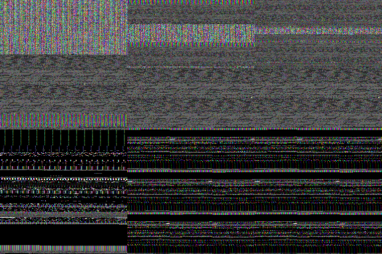

# 当前 RGB 微诊断与单一局部修复：PARTIAL / REPAIR_FAILED

**当前坏图在 raw readback 边界即已出现；观察到 context 释放事件链，但显式绑定 context 没有修好图像。** 原协议v3 SHA `022ab690a7852290f41a62294d100c295ac9753c48f8929d852b01aef9ef09d8` 未变。本轮已停止，不再叠加第二种修复、不增加进程、不恢复原模型诊断。

结论分开：当前故障复现 **YES，限一个有效渲染进程/固定 sample0**；单次绑定能恢复当前 context **YES**；健康图像修复 **NO**；生命周期触发有直接遥测，但所有buffer失效的触发路径 **未完全定位**；旧训练0/32历史因果 **UNKNOWN**。没有新的ACT或任务成功率证据，原 D/IMPLEMENTATION-LIMITED 边界保留。

## 执行与工程失败

先完整读取新授权、v3和DeepSeek15/16/17（含17两条非阻塞注记），冻结样本/来源/脚本SHA/预算/因果审计后运行。只写render_repair，旧execution保持只读。Git index全程归主线程，执行者没有stage/commit/push。

初始worker1在 `before_make_env` 遥测遇到本次代码错误：对PyOpenGL NULL opaque context读取`.address`触发ValueError。该进程在任何render/readPixels、实际make_env之前退出；仍保守占用1个worker及1次make_env预留计数。完整失败保留于initial_attempt_completion.json、worker_1_process.json及本地日志。

按工程修复范围修正NULL指针处理，保存原脚本和diff、前后SHA。没有重启已terminal的初始supervisor；另一个工程恢复supervisor用原累计计数/时限，仅exec剩余worker2名额。worker1先退出，worker2后启动，两个进程记录可核对。worker2完成3 baseline→3同一repair后因修复门失败退出1，保留全部数据。**本轮只有一个有效渲染进程，未完成两个有效进程的独立复验。** 工程恢复顺序与原计划的“两次有效baseline/repair复验”不同；不能将本轮报告为完整协议PASS。没有把失败进程从资源账中抹去。

## 逐帧原件与数值

我实际查看了这张六图拼图：上下两排均不能辨认健康Lift机械臂/目标场景，仍有彩色条纹/噪点。修复不能凭context匹配或图像相似就称成功。

| 条件 | 三个入口的current / target | framebuffer查询 | readPixels后error序列 | sentinel保留165比例 | 健康图像 |
|---|---|---|---|---|---|
| baseline 3帧 | null / ctx2 | null，NO_CURRENT_CONTEXT | null，不对无context调用GL查询 | 各1.0 | 否 |
| 单次绑定 3帧 | ctx2 / ctx2，匹配 | 各33305 /0x8219 | 各[1282,0] /[0x502,0] | 各1.0 | 否 |

修复的mjr_render后记录[1286,0] /[0x506,0]。运行时PyOpenGL绑定将0x8219、0x502、0x506分别命名为GL_FRAMEBUFFER_UNDEFINED、GL_INVALID_OPERATION、GL_INVALID_FRAMEBUFFER_OPERATION。不是健康的36053 /0x8CD5。MuJoCo con字段仍为currentBuffer=1、offFBO=1、offFBO_r=2、offWidth640/offHeight480/offSamples4；这些字段存在不等于GPU对象仍有效。

遥测固定为context→有效context时framebuffer→最多8次glGetError→原调用→同序后测。所有有context的序列均遇NO_ERROR结束，没有把8次上限冒充排空。**查询会清除错误且可能产生错误，错误码属于包含查询的观察区间，不能把所有错误排他归因于原native调用。** 无context不查询GL，不为遥测绑定。额外sentinel在read_pixels返回前、原render锁仍持有时执行；正常np.empty及其buffer没有被填充或替换。

sentinel与同帧pre-flip raw比较，所有6帧sentinel的165完全保留，而正常raw的165比例约0.000061–0.001175。不能仅凭颜色残留判定正常buffer未写入；本轮**没有获得健康正常对照**。结合缺context/异常FBO/error及raw坏图，支持当前readback前提无效；不能据此宣称已经完整解释driver或全部framebuffer机制。

六帧各保存：正常mjr_readPixels返回后raw、read_pixels返回前flip前拷贝、实际flip输入/输出、float tensor、保存NPZ/PNG；额外sentinel单独保存，永不进入正常流水线。CPU逐项验证30个边界关系全部精确一致。因此当前坏图已经在raw边界，并非仅由后续flip、float/255或PNG保存产生。共同raw RGB经三种纯RGB预处理公式也逐元素相同；这不证明ray几何或模型输出等价。详见analysis.json、results/worker_2/entries.json、readback.json和逐次*.npy/NPZ。

## 生命周期事件链及仍未解决之处

匿名events.jsonl的零基索引：

1. index23 after_make_env：ctx2当前，framebuffer36053；index24 before_Dataset仍36053。
2. index25旧ctx1的free入口：ctx2仍当前，但framebuffer已变33305。
3. index26–27 eglDestroyContext前后ctx2仍当前。
4. index28 eglReleaseThread入口ctx2当前，index29出口current=null。
5. index33 after_Dataset、35 after_Evaluator、36 after_embedder及三帧基线均无当前context。

这条链**实际记录到旧ctx1释放期间eglReleaseThread将线程当前ctx2解除**，比仅看源码存在release更强。失效发生在Dataset构造区间；不能将它直接称为Dataset算法错误，也没有记录主动gc.collect（本诊断没有主动调用）。记录/复制可能改变分配和GC时序，仍是外推限制。

另一个问题已经在index24→25间出现：framebuffer先于旧EGL free入口变为undefined。固定源码的MjRenderContext析构先con.free再gl_ctx.free，故“旧con在新context当前时释放同名GPU资源”是有针对性的候选；但**本轮没有逐调用插桩MjrContext.con.free，不能把这条具体buffer破坏路径写成已证明因果**。单次make_current恢复ctx2后buffer/readback仍坏，说明它不足以解决当前问题。

唯一修复在原MjSim.render已持有_MjSim_render_lock时，通过未绑定MjRenderContext.render窄wrapper绑定目标一次，render后/read入口核对，不再绑定、不新增锁。原物理state/XML/camera hash在6帧相同。repair_choice.json在修复前落盘，模块为scripts/context_binding.py。它是**失败的候选模块**，不能向旧训练部署或称已验收修复。首修失败后按规则停止，未尝试第二种buffer/驱动/环境改动。

## 资源、计数和完整度

- OS worker **2/2**：第1个工程失败，第2个有效；实际创建环境1个，make_env持久预留**2/2**，不回收失败预留。
- 底层mjr_render **6/12**；mjr_readPixels **12/24**，含6正常+6额外sentinel；hook在make_env前安装，未记录初始化/cleanup额外渲染。不把预留计数当健康成功数。
- GPU分配墙钟累计 **23.1327807279秒 /300秒**，覆盖两个worker完整生命周期。初次3.4354224978秒，余下约19.697358秒。无GPU并行，两个PID/start_ticks/起止/退出码保留。释放后仅余开始前既有用户GPU进程。
- ACT **0**、env.step **0**、rollout **NOT_RUN**、optimizer update **0**。初始化/forward内部引擎操作与env.step分开，不声称物理引擎没有任何内部操作。
- 无新安装、下载模型数据、改旧源码/驱动、训练、正式test；没有Git index写入。
- 初始冻结含所有脚本；工程修复原件/diff与工程恢复脚本SHA单独冻结。旧execution受检76文件size/mtime/SHA、所复用源文件SHA均未变，见integrity.json。原始context地址仅local_only，公开事件只含稳定代号。

完整度为 **PARTIAL / REPAIR_FAILED**。受控停止的原因既包括一次本次遥测工程失败消耗进程名额，也包括唯一修复未恢复健康readback。第二个有效进程复验为null+NOT_RUN；未扩大到第三个进程。未用完render或GPU额度不构成继续授权。

## 交付与下一步边界

主线程应独立读取raw数组、事件索引和修复代码，再让真实DeepSeek质疑。下一候选若被另行审查，应针对已记录的“旧renderer释放、新context的buffer失效及线程解除”链，补齐con.free边界与健康对照；本轮没有执行该候选、重建buffers、修改旧环境或恢复模型诊断。旧训练历史没有RGB/GL证据，0/32根因仍UNKNOWN。

commands.jsonl、worker_*_process.json、两个supervisor身份/退出、budget/run_manifest、engineering_repairs、repair_choice、analysis、integrity与completion共同构成回执。GPU停止独立于对话额度；初始终止和工程恢复均已结束。全部成果交父线程统一公开同步；自身检查完成后暂停，另存本轮一次性回传回执。**不要重启任何本轮terminal supervisor或自动继续旧32前向/16闭环。**
