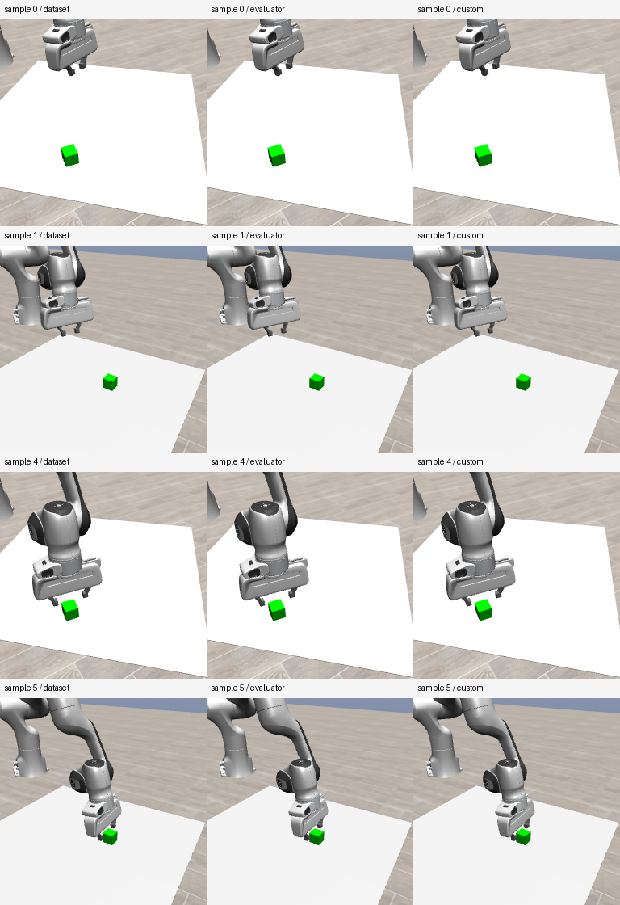
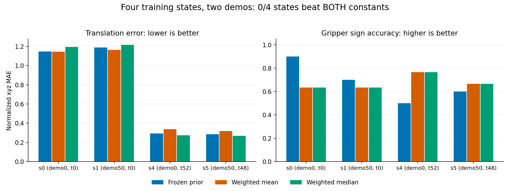
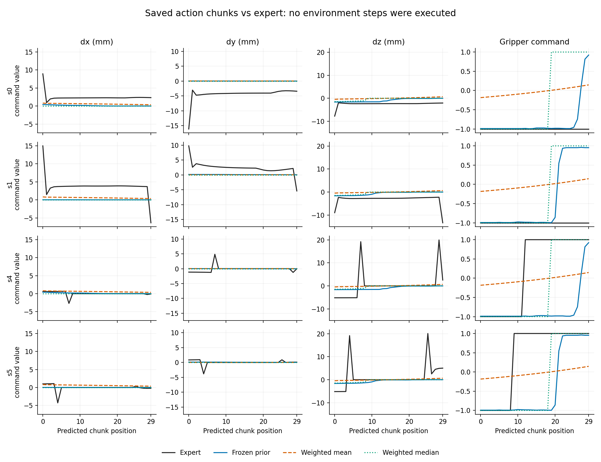

# F 最后一轮有限恢复：联合验收与研究决策

本轮确实完成了健康 RGB 下的冻结 ACT 评估。**工程阻塞已经跨过；当前 checkpoint 的优先 F 路线建议暂停，Stage2 不放行。** 模型在四个训练状态上仅略优于常数的总体平移误差，没有一个状态同时胜过两种强常数，未达到事先冻结的继续投入门槛。没有发现足以解释本轮弱表现的明确、可修复工程原因。

这不是“证明模型一定不能完成 Lift”，也不是否定 F 或 KYC。准确外参闭环本轮没有执行，任务能力仍未建立。科学状态为 **SCIENTIFIC_MEASURED / INCONCLUSIVE_MIXED_OR_WEAK_SIGNAL**；当前 checkpoint 的继续投入和本轮闭环为 **No-Go**；未取得 **POTENTIAL_F_SIGNAL**。

本报告依据 [用户原任务书](00_本轮用户任务书_原文.md)、[冻结协议](PROTOCOL.md)、[父审独立重算](artifacts/parent_model_recomputation.json)、[DeepSeek 独立验收](discussion/36_model_independent_response.md) 和 [最终交叉意见](discussion/37_model_cross_response.md)。全文十问对应原任务书，不追加实验授权。

## 1. 已知模块冲突是否修复

是。本轮新 harness 使用 `kyc_recovery` 包及相对导入，真实加载器核对官方模块的文件来源与身份；没有向错误 `common` 补字段，也没有删除 `sys.modules` 掩盖冲突。

两轮修复已全部使用：R1 隔离命名空间，真实 CPU 运行越过旧 ROOT 导入错误；随后暴露 h5py 平台检查打开 `/dev/null` 被新写保护拦截。R2 只放行该设备的 `open`，保留范围外写入、删除、重命名限制。R2 与最终无修改 CPU 覆盖均 exit0；后续 GPU 真实构造和科学运行也均成功，没有第三轮修复。

CPU 预检实际读入 375 个 checkpoint 张量和真实上游模块，核验 args、统计量、ROOT/DATA/atomic_json/utc；CUDA 未初始化、无 GL 导入、无模型构造。安全分支的导入不等于设备构造已测；剩余路径在唯一一次 GPU 预检验证。见 [CPU 报告](CPU_PREFLIGHT_REPORT.md)、[修复账本](repair_ledger.json)、[CPU 与 GPU 原始证据的公开导出说明](publication/README.md)。

## 2. 真正执行过哪些入口与调用

执行者为指定的 **GPT-6.1-sol / max**；同一现有 Python、工作目录和 `run.py` 入口，三个 GPU worker 顺序执行。先完成实际输入构造与模型 strict load 的 GPU 预检，再采图并退出，Codex 实际检查 12 张图及原数组后才派发模型阶段。等待审核时没有 GPU worker 驻留。

| 阶段 | 实际执行 | GPU 分配秒 | ACT / render / readPixels | 结果 |
|---|---|---:|---:|---|
| GPU preflight | input_setup→close_input→model_setup→close_model | 16.885045 | 0 / 0 / 0 | exit0；限定路径 ENGINEERING_READY |
| S1 input | Dataset / Evaluator / custom 各四图 | 19.854562 | 0 / 12 / 24 | 健康门通过，90 文件锁定 |
| S1 model | 官方 prior 4、自定义 prior 4、posterior 4、重复 4 | 16.663939 | 16 / 0 / 0 | exit0；16 内部前向与16完成事件 |
| S2 accurate 闭环 | 未派发 | 0 | 0 / 0 / 0 | NOT_RUN，S1 门未通过 |

固定样本 s0/s4 来自 demo0、camera1、t0/t52；s1/s5 来自 demo50、camera51、t0/t48。每个动作块 30×7，有效步均为30。模型参数 FP32、推理 BF16 autocast、TF32 关闭；没有 warmup、额外前向、换模型或训练。

12 组 normal/sentinel RGB 完全一致，60 个保存边界精确一致；源状态、动作与 mask 对齐，三入口浮点输入最大差约 5.96×10⁻⁸，在冻结容差内。sample0 与已验收健康图 SHA 一致；主审逐图查看了下图全部12帧。本轮自然析构目标窗口未出现，记 `NOT_REPRODUCED`，不冒称再次复现了旧资源释放故障因果。

原始输入见 [inputs](inputs/)，读回和保存边界见 [results/input](results/input/)，验收见 [notes/07](notes/07_父审健康输入验收.md) 和 [input_gate](input_gate.json)。

## 3. 预算、准确 SHA 和停止证据

总分配 **53.403545791 秒 / 1800 秒**，其中 S1 **36.518500963 秒 / 600 秒**；3 GPU worker、2 make_env、16 ACT、12 render、24 readPixels，**0 env.step、0 rollout、0 backward、0 optimizer 更新**。GPU 预算包含初始化及退出清理；剩余预算不能越过阶段门。采样最高 RSS 约1.80 GiB、整设备显存1269 MiB，均低于16 GiB/12 GiB限额；采样值不是连续峰值保证。

正式 S1 派发为 **2026-11-03 15:15:36.691306（北京时间）**，硬截止 **23:15:36.691306**，没有延长。最后模型 worker 已在15:23:19退出；之后只有已保存数据的 CPU 算术、审查和报告。所有阶段 exit0、租约清空、无 terminal stop；停止原因是冻结科学筛选失败，并非资源耗尽。

| 对象 | SHA256 |
|---|---|
| 冻结协议 PROTOCOL.md | `3fd12394fd845a4c2df528119655af65ab1a830b55833f5aa278c0c8c004c460` |
| candidate_manifest.json | `bd4233fbeca8898d0145c3411ae98901897fd24b974984c3b83195cea75843ed` |
| 现有 C_latest.pt | `c904a97002571d96e3ee6b66057d09162cbdcb5e926cb6ea0b660ca1390bce13` |
| 训练数据文件 | `fc89e2a46624b877cd35ae383df9ad09a84b7881c655bc114812164d6ff45377` |
| 原加权常数 | `deae440f7222d5e2140e68f44703c3fac31efb423975b34b323df3c34b2d3b1a` |

manifest 锁定55个候选文件及113个只读源文件，主审验收时逐项复核。原协议中的“候选/待批准”是冻结前的历史状态，后续真实授权见 [engineering_gate](engineering_gate.json)、[scientific_freeze](scientific_freeze.json)、[science_gate](science_gate.json) 和 [input_gate](input_gate.json)，不回写冻结协议。原始 [stages](stages/)、[单一累计账本](recovery_state.json)、[调用日志](model_events.jsonl)、[资源日志](resources.jsonl)、[命令记录](commands.jsonl) 保留。

执行者的运行后核验曾把16个 NPZ 加16个 JSON 误当“只应16文件”，触发一次核验脚本断言；读源码后修正了只读核验。这不是科学 worker 失败、代码维修或新增推理，见 [原说明](artifacts/s1_model_executor_verification.json)。

## 4. prior 对专家动作和强常数表现如何

每个状态先在有效30步上算误差，再四状态等权。常数是原训练采样分布按动作块位置计算的 **30×7 加权 mean / median**，不是本轮四样本拟合的常数。两常数都报告，不择优更换基线。↓越低越好；↑越高越好。

| 指标 | 官方 prior | 动作条件 posterior | 强 mean | 强 median |
|---|---:|---:|---:|---:|
| xyz 标准化 MAE ↓ | 0.728540 | 0.728892 | 0.740696 | 0.738244 |
| 7维标准化 MAE ↓ | 0.539282 | 0.539603 | 0.592716 | 0.543627 |
| 逐状态 RMSE 的均值 ↓ | 0.934486 | 0.934641 | 0.883127 | 0.928284 |
| 平移动作方向余弦 ↑ | 0.498815 | 0.514871 | 0.480083 | 0.288077 |
| 夹爪 sign 准确率 ↑ | 0.675000 | 0.675000 | 0.675000 | 0.675000 |
| 夹爪 transition Hamming ↓ | 0.051724 | 0.051724 | 0.051724 | 0.051724 |

prior 平移 MAE 比 mean 改善 **1.641%**，比 median 改善 **1.314%**；7维 MAE 比 median 仅改善 **0.799%**。这远低于冻结的20%投资效应门。20%不是统计显著性阈值，不以四状态作总体显著性结论。pooled RMSE 分别为 prior 0.961411、posterior 0.961579、mean 0.923867、median 0.972904；它与表中的“逐状态 RMSE 均值”不能混用。

| 状态 / 来源 | prior xyz MAE | mean xyz MAE | median xyz MAE | 夹爪准确率 prior / median | 同时胜两常数 |
|---|---:|---:|---:|---:|---|
| s0 / demo0 | 1.145472 | 1.143031 | 1.193490 | 0.9000 / 0.6333 | 否 |
| s1 / demo50 | 1.187711 | 1.163263 | 1.215921 | 0.7000 / 0.6333 | 否 |
| s4 / demo0 | 0.294535 | 0.337626 | 0.274060 | 0.5000 / 0.7667 | 否 |
| s5 / demo50 | 0.286441 | 0.318863 | 0.269504 | 0.6000 / 0.6667 | 否 |

**0/4 同时胜双常数**，要求至少3/4并覆盖两demo。s0/s1 输给 mean，s4/s5 输给 median。总体方向指标的改善不能掩盖局部退化：s4/s5 夹爪准确率0.50/0.60，低于 median 的0.7667/0.6667；s4 方向余弦0.5697，也略低于 median 的0.5816。保持原冻结门，不用这些事后描述改门。

| 动作维 | prior 标准化 MAE | median 标准化 MAE | prior 原单位 MAE |
|---|---:|---:|---:|
| Δx | 0.751958 | 0.768490 | 1.753885 mm |
| Δy | 0.935023 | 0.938962 | 1.950065 mm |
| Δz | 0.498638 | 0.507279 | 2.403315 mm |
| 旋转坐标 Δrx | 0.290473 | 0.290150 | 0.008709 rad |
| 旋转坐标 Δry | 0.171611 | 0.171592 | 0.009913 rad |
| 旋转坐标 Δrz | 0.460951 | 0.466064 | 0.001224 rad |
| 夹爪命令 | 0.666323 | 0.662851 | 0.653405 无量纲 |

旋转三列是 axis-angle 坐标增量误差，不是独立姿态测地角；夹爪无量纲。不同单位不直接合成“物理总误差”。完整 prior/posterior/mean/median 逐维数据见 [CSV](artifacts/action_dimension_errors.csv)，逐 demo、块位置和多样性见 [analysis.json](analysis.json)。

同相机配对0↔4、1↔5，RGB分别有16.1%/17.2%像素位置变化，专家平移的配对逐维平均差约2.4–4.9 mm，prior 仅约0–1.24 μm；专家夹爪块差1.2/1.4，prior 约0.00051/0。说明这两对状态里预测随任务进展变化很弱。它不是全局视觉消融，不能证明完全没有视觉依赖。四状态分属两种相机/T条件，不能泛称“只有图像变化”。见 [配对原值](artifacts/parent_paired_state_description.json)。

上图横轴是**预测块位置，未执行的环境步**。完整7维、16次推理及专家的可检查数值在 [action_chunks.csv](artifacts/action_chunks.csv)、[16个原始NPZ与JSON](results/predictions/) 及 [无损JSON审查包](review_packets/model_originals/)。posterior 与 prior 近似，没有实质优势；每状态只有一次条件采样、BF16精度，不能据近零mu/logvar断言潜变量塌缩，也不能推断加训练或改KL就有效。

## 5. 官方与自定义入口是否一致

在相同健康 canonical raw RGB、qpos、Plücker及camera token下，**四状态首次官方/custom prior 输出逐位相同，最大绝对差0**。s0/s1各入口自身重复差也为0；s4/s5未重复，只能说其单对入口吻合。strict load 的375项无 missing/unexpected，输入克隆防止原地归一化污染，prior未接收动作标签。

这支持“本轮选定状态的自定义入口忠实复现官方 prior”，不能推广为所有状态/硬件/精度都等价。对应容差、逐次seed与原输入hash在 [call_plan](call_plan.json)、[model_result](model_result.json)、[strict_load](strict_load.json) 和 [父审原数组重算](artifacts/parent_model_recomputation.json)。

## 6. 闭环成功、reach、grasp 是多少

**全部 NOT_MEASURED，Stage2 NOT_RUN；不是0/16。** 两项必要的数值继续门失败，双方均不放行。无初始root执行、无轨迹、无闭环策略查询，不能给Lift成功率。旧0/32结果的历史原因仍为 **UNKNOWN**，本轮不把它归因到RGB或checkpoint。

因此用户两项基础问题的答案分别是：①已获得真实动作预测，但尚未建立值得部署的动作能力；②准确相机下能否完成Lift，本轮仍未测得。详见 [正式阶段决定](stage2_decision.json)。

## 7. 当前 checkpoint 是否值得继续

**不值得继续作为硕士小论文的优先投入路线。建议保留权重与证据，停止本轮及当前链上的自动修复、加训练、闭环追加。** 健康输入、严格加载、入口一致和数值稳定这些已知障碍通过后，有限训练状态仍仅略优于常数，且对任务进展响应很弱。当前没有明确、已证实的可修复原因，不能用“再调一轮可能变好”支持继续。

这是一项在高排障成本和有限正向证据下的投入决定，不是断言模型完全没学到东西，也不是方法总体失效。四状态、两demo均来自训练集；没有独立测试任务、视觉消融或学习曲线干预。单次posterior、BF16与无闭环均限制解释。

## 8. F 的核心科学假设还缺什么

F需要检验的是：在公平匹配扰动边际和幅度时，episode-persistent 外参误差是否产生不同于IID误差的任务退化/恢复规律，以及可用方法是否改善它。当前只验证了健康输入动作评估链，**还缺最前面的可信准确标定任务基线**。未施加IID或persistent扰动，不存在F机制效应或算法增益证据。

若研究负责人未来另行批准，判断 Potential Go / No-Go 的最少证据顺序如下；这是资格清单，不是新实验任务书。

| 顺序 | 必要证据 | 停止/继续依据 |
|---|---|---|
| 先建立准确外参阳性 | 官方权重、冻结官方入口，在独立来源物理初态上复验成功/reach/grasp与轨迹；需要足以分辨退化的稳定行为 | 无可信阳性或再次主要靠未知工程修补：No-Go，不能先研究标定误差 |
| 再比较时间相关性 | 同初态配对 accurate / IID / episode-persistent；至少两个预定非零幅度；匹配单次扰动边际和幅度；任务来源独立，预定指标与停止规则 | 匹配后无可重复差异，或基线已在所有扰动下失效：当前F问题不获支持 |
| 最后判断增量价值 | 简单重新标定、常规扰动鲁棒性对照；成功、恢复及误差指标；不泄漏真实位姿/未来状态 | 简单对照解释或消除全部收益、成本过高：不启动新算法；有可重复任务差异和未解决缺口才是 Potential Go |

样本量必须按新基线稳定性和预期效应另行预注册，不能把当前四状态或计划中的8root×两相机视作足够独立证据。Stage2未建立基线，Stage3的触发条件不存在，本轮不提交伪装成可直接执行的完整F方案。

## 9. 继续 F 还是转向可靠开源基线

以尽快完成硕士小论文为目标，**优先寻找并复验已有官方权重、明确任务成功证据的开源基线，比继续救当前checkpoint更值得**。理由是当前核心风险仍在基线任务能力，继续F会把时间投入不确定的训练/实现诊断，尚无法测到拟研究的机制。

这不是已验证某个替代模型一定更好。本轮按授权没有重开文献搜索、下载权重或替代基线实验。下一次批准应先对候选的权重可得性、官方任务阳性、硬件成本和入口可复验性做短清单核实，再决定是否保留F问题；不必先承诺F或新算法。

## 10. 唯一推荐方案、双审与交付

**唯一推荐：封存当前checkpoint的优先F路线；由研究负责人另行批准“可靠官方基线的短程资格复验”。** 本轮不自动派发下一阶段。当前停止条件已触发：健康输入下20%及3/4双常数门未通过，且没有明确可修复原因。以后若未建立准确标定阳性，不进入persistent/IID，更不开始完整训练或新模块研发。

Codex先对16个原NPZ和输入独立用float64重算，保存结果后才对照执行者analysis，核心指标一致。真实DeepSeek通过既有终端Claude连接，返回模型字段为 `deepseek-flash`；第36轮先看独立提供的原始JSON数组包与运行证据，未先读Codex notes/08；其审查是独立阅读和核对，**不冒称另跑了一套CPU算术脚本**。随后第37轮交叉接受结论、保留局部夹爪退化，并收紧“只有图像变化/塌缩”的措辞。见 [Codex独立意见](notes/08_Codex模型结果独立验收.md)、[交叉质疑](notes/09_模型验收交叉质疑.md)、[最终联合记录](notes/10_最终联合验收.md)、[真实会话公开回执](publication/deepseek_receipts.json)。

第32轮旧会话API400上下文已满，无有效批准；保留失败证据，通过交接新会话的32b/33完成真实候选双审。没有模拟DeepSeek结论。前序候选/预检/S1审查、两轮修复、精确SHA、运行原件、双方意见与最终决定均纳入公开允许清单；原生地址与会话原始CLI留本地，公开导出保留原件hash和删减规则。未公开凭据、权重、环境、XML或完整数据集。

**交付完成只表示本次授权的执行、验收与公开闭合；不表示已建立可部署策略、可信Lift基线或可立项的F科学证据。** GitHub同步结果以 [publication/remote_verification.json](publication/remote_verification.json) 和 [completion.json](completion.json) 为准。现有重置卡仅获“周额度实际耗尽且任务未完时一次”的授权；截至报告生成尚未使用。
