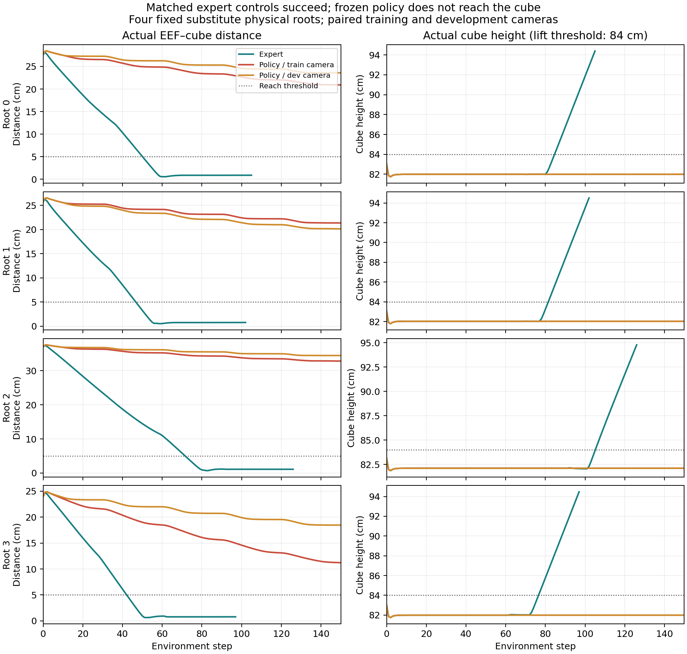

# KYC 0/32 专项抓取诊断与研究决策

2026-11-05｜独立验收与最终交叉讨论已完成，DeepSeek第51轮要求的三处表述勘误已落实。组织与独立数组验收：Codex；独立原件审查：真实 DeepSeek；工作站执行：GPT-6.1-sol / max。

**建议停止当前 checkpoint 的恢复，暂停依赖它的 F 实验。旧 0/32 的历史训练根因仍未唯一定位。** 本轮得到的是完整任务行为负例：同一组物理初态上，专家 4/4 成功；策略在训练相机和开发相机下各 0/4，均未接近或夹持。有限训练输入检查没有观察到坏图，但不能证明旧训练全程健康。

## 实际结果

|阶段|执行量|结果|GPU 分配秒|
|---|---:|---|---:|
|限定预检|4 root、2 帧、375 tensor strict-load|通过；0 ACT/step|34.581207|
|A 匹配专家|4 条，105/102/126/97 步|success/reach/grasp 均 4/4|75.479510|
|B 冻结策略|4 root×训练/dev 两相机，各150步|两相机各0/4；reach/grasp均0|201.265869|
|C 本地 reader|10 validation+12 train item|短采样健康，异常释放窗口未复现|28.542387|
|C 加官方两处检查|同样22 item|检查未触发reset；两臂batch逐位相同|27.843600|
|合计|5个独立worker，均正常退出|现无GPU作业|**367.712573，约6.13分钟**|

总计40 ACT、12条轨迹、1630环境步、44 getitem、102 render、204 readPixels，0 backward/optimizer更新。初始化与清理均计入分配秒，低于900秒上限；没有挪用省下的预算追加实验。全部实验在2026-11-05 09:43:16科学截止前结束。81个候选文件和396个只读来源的SHA最终核验不变。

四个root在行为执行前冻结XML/state/controller/RNG，A/B使用同一恢复、动作和成功接口，逐次核对实际仿真状态及物理指纹。**源数据缺逐demo XML，因此只能称有来源依据的替代场景，不能称完全恢复原示教或原32个开发物理初态。** 旧专家10/10没有被借作本轮阳性。

A的原动作逐位匹配源头，EEF对示教next_obs的最大偏差仅0.286毫米；四条均成功抬升，reward==1与原_check_success一致。约1.5厘米的EEF到瞬时控制目标跟踪误差是另一个量，不能混为专家复现偏差。

B的40个原动作块经float32反归一化重算，与1200步实际执行delta逐位一致。实际官方policy返回与内部输出在运行门逐位核对；未更改累计目标语义、成功标准、参数或初态。48帧正常/独立sentinel读回相等，96次read的FBO/GL检查通过。实际EEF跟随输出，目标跟踪误差中位0.53–4.13毫米，但最近EEF–物体距离仍为11.23–34.44厘米，全部超过5厘米reach阈值。

策略也并非完全恒定：root3训练相机下实际X位移11.87厘米，dev仅0.074厘米；前者仍未reach，且150步夹爪命令始终≤0。多条轨迹以向下移动为主，横向对准不足。当前失败链因此具体到了“输出没有形成有效接近和抓取”，不是只有一项MAE不达门。

|冻结物理初态|训练相机最近距离（米）|开发相机最近距离（米）|策略success / reach / grasp|
|---|---:|---:|---|
|root0|0.20913|0.23594|两条件均0 / 0 / 0|
|root1|0.21380|0.20158|两条件均0 / 0 / 0|
|root2|0.32824|0.34443|两条件均0 / 0 / 0|
|root3|0.11226|0.18465|两条件均0 / 0 / 0|

相机条件同时改变RGB和外参输入；上述变化不能单独证明网络使用了RGB，也不足以将失败归因于某一输入分支。

## 训练输入与源码证据

C复用了真实EpisodicDataset、动态渲染、RandomCrop和default_collate。两臂各22项完整batch均保留；父审核对全部状态/动作时间片、float32归一化和padding/mask与HDF5一致。每臂6组保存的双readback重算至实际crop/batch；每臂1个完整pre/post代表的9通道共同crop也逐位匹配。全部44张实际post-crop RGB无明显条纹或空帧，两组预定重复的9通道tensor逐位相同。

两臂所有实际batch tensor逐位相同。官方两处检查虽执行，却没有触发reset，**不能说本次证明guard修好了故障**。每臂另16组raw未重复保存，只有运行时双读hash/健康记录，但其完整实际post-crop item仍可核验；不能写成父审重算了全部raw。

检查没有强制GC/析构、没有安装owner修复，未复现此前的自然异常释放窗口；它不重演4.57小时训练或官方周期评估完整生命周期。状态和动作索引对应已核，原示教几何身份仍因缺XML而未知。

源码比较确认：

- 官方train.py在epoch开头及验证/评估后、整轮训练前各有一次framebuffer检查，异常时reset；本地省略。它不是逐minibatch检查。
- 官方周期评估与训练共用env；hard reset重建仿真/context并可能重新采样几何。本地省略周期评估也改变这一生命周期。这是实现差异，尚未证明导致旧0/32。
- 作者Lift的paper_runs.yaml明确覆盖为**150步**，不能把通用默认300步当作本次标准。
- 官方wrapper将六维delta累加到上次绝对目标，夹爪不累加；官方eval与旧evaluate都使用float32反归一。先前离线分析的float64不应进入控制，不能虚构成旧部署错误。
- policy内部RGB normalization使外/内image hash不同，这是预期。父审初版分析的一处错误断言已修正并留痕，未改实验。
- 60,003次更新和loss下降不能证明图像健康；旧日志缺逐帧RGB/FBO/最终tensor，无法追认历史污染。

固定源码位置与完整对照见[SOURCE_AUDIT](SOURCE_AUDIT.md)及[生命周期补充](notes/07_训练循环差异补充.md)。作者评估与本轮四个固定替代root的取样不同，不作成功率等价比较：[论文](https://arxiv.org/html/2510.02268v1)、[固定版本Lift配置](https://github.com/ripl/CamPoseOpensource/blob/e0647105a0f3946581d253c55dc9fd1218fa0974/reproduce/paper_runs.yaml)。

## 六个研究判断

1. **旧0/32根因已定位吗？** 没有唯一历史根因。本轮明确了当前无效动作与未接近的行为链，并削弱“控制不能执行”“只是开发相机”的解释；不能推断权重形成的唯一原因。
2. **训练相机有任务阳性吗？** 没有观察到：success/reach/grasp各0/4。有限负例不证明模型在所有场景绝对无能力，也不代表复现了论文。
3. **学习问题还是部署/数据/相机问题？** 当前健康输入、控制与执行链工作，权重却未给出有效动作。学习/prior、训练场景对应、历史污染、表示与优化等假设仍不能分离；不能仅归因开发相机，也不能称模型完全不看图。
4. **有具体可修复且关联旧0/32的错误吗？** 旧受控诊断确有owner-context释放错误；本轮没有建立它到旧训练/0/32的因果链。缺guard/周期评估是代码事实，不能自动升级为根因。
5. **最小修复及是否重训？** 已知生命周期问题可做工程防护，但本轮健康输入未救活权重。没有证据支持现在再修模块或增加epoch；只有未来独立确认训练污染等具体原因，才讨论另行批准的受控训练，本轮不执行。
6. **继续以KYC支撑F吗？** **当前checkpoint路线No-Go，停止恢复及依赖它的F实验。** F的一般假设未被证伪，但尚无有效任务基线支持外参机制研究。以尽快完成硕士小论文为目标，后续若另获授权，优先选择已有官方权重、可复验任务阳性和明确环境/场景来源的基线，性价比高于继续救当前权重。本轮不自动展开新搜索、训练、闭环或算法。

## 独立验收与复核入口

Codex独立重算原NPZ、HDF5、完整轨迹和实际batch；DeepSeek先读原JSON/日志、带SHA的动作逐值转写及图像，再交叉质询。DeepSeek没有独立执行NPZ解码，不能把父审计算说成双方各自数组重算。

- [Codex独立六问](notes/17_Codex最终独立验收与六问.md)、[DeepSeek独立六问](discussion/50_final_independent_response.md)、[最终交叉](discussion/51_final_cross_response.md)。
- [交叉验收与勘误落实](notes/18_最终交叉验收与报告勘误.md)、[真实调用脱敏回执](publication/deepseek_review_receipts.json)。原始意见按时间保留，50中的旧Stage3术语已由51撤回，不能作为后续授权。
- [逐root行为指标](artifacts/behavior_by_root.csv)、[预测与执行复核](artifacts/parent_policy_b_acceptance.json)、[两臂batch复核](artifacts/parent_c-official_acceptance.json)、[最终来源与预算核验](artifacts/parent_final_execution_integrity.json)。
- 原轨迹、动作块、读回与batch在results/，CPU重算脚本在scripts/。公开响应与脱敏调用回执；完整CLI、原XML、原生地址映射、环境和凭据不公开。
