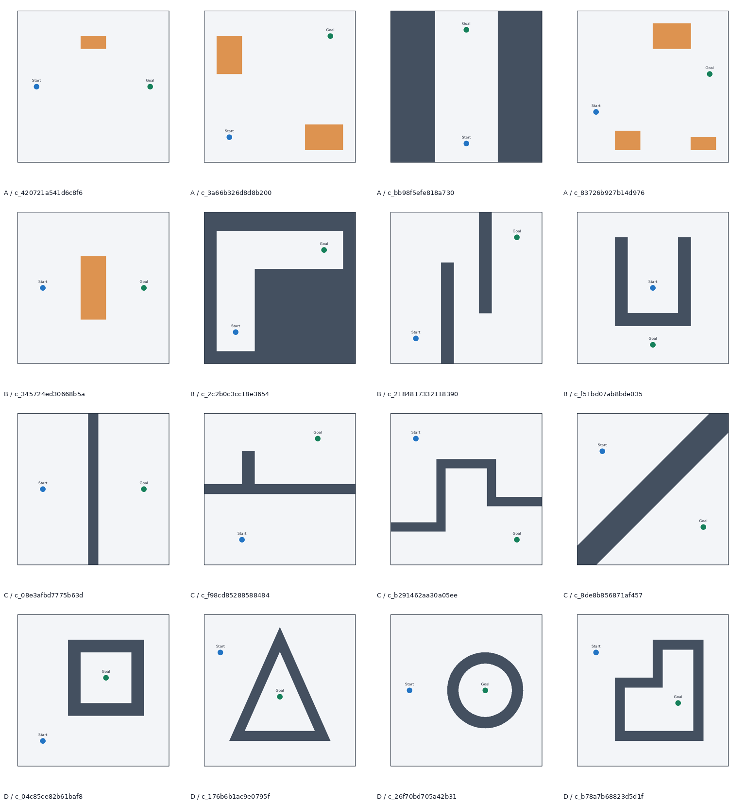

# Phase 3.6 — VLM 基础二维空间能力校验

报告时间：2026-10-21T01:34:46.669562+00:00。诊断性先导实验，16 个新控制布局，每个只进行一次正式贪心推理。

**本轮结果为 12/16（75%）：A=4/4、B=1/4、C=3/4、D=4/4。模型输出可达 6 次、不可达 10 次，没有重现恒不可达。**
全部四个明显直线正例被正确判为可达，但四个绕行正例错了三个，另有一条贯穿边界的墙被误称可以绕过。
**建议 No-Go：当前不宜进入以“纯反事实组合缺陷”为前提的后续研究。** 先由研究者复核本轮基础全局通路错误；本任务不启动新的实验、换提示、训练或 Phase 4。

## 1. 实验目的和对照设计

Phase 3 的六核心假设编辑预测合计正确 6/18；Phase 3.5 直接展示 24 张后态图后，模型全部预测不可达，14/24 正确，等于该组恒否基线。
因此本轮移除所有编辑操作，使用 16 个新布局，检验直线通行、绕行、真实隔断、目标封闭和否定偏置。
A/B 各四个可达，C/D 各四个不可达，构成 8:8 平衡对照。目的在于定位基础能力，不能用准确率单独确认研究假设。

## 2. 场景构建、合法性及真值验证

生成器为新增 control_scenes.py；已有 geometry.py、oracle.py、render.py 及旧数据逐字节保留。16 套米制布局由明确坐标一次性构造，
没有旋转/镜像旧六场景、按模型结果筛选或失败后自动换样本。生成 seed=20261021 用于稳定不含类别的 ID 和样本顺序打乱，布局坐标本身为确定性构造。
A 包括开阔横向、对角线、宽竖直通道、浅斜线穿越；B 为中央块绕行、L 走廊、交错挡墙、U 内出发经开口绕到外侧；
C 为竖直、带支墙水平、阶梯折线及对角带隔断；D 为矩形、三角形、环形及非凸阶梯封闭庭院。

机器人为半径 0.25m 的圆盘，可二维自由平移，不约束朝向；墙体/障碍/地图边界接触均不允许。地图统一 12×12m。
Shapely 验证全部几何合法，起终点无碰撞；圆弧膨胀使用旧代码 32 段/象限和 1e-6m 接触 epsilon，加外扩补偿弦近似。
旧 Oracle 分别在 0.10、0.05、0.025m 四邻接网格运行，边线段和端点连接都做碰撞检查，共 48 次搜索，16 个标签全部一致。
另以 GEOS 对圆盘配置自由空间做 polygon difference/连通分量分解，与三网格结果逐一一致；它不读取类别或设计预期。类别意图只在求解后作生成验收断言。

正例另有逐段通过碰撞检查的设计参考路线，参考路线最小额外净空为 0.65–1.75m（已减去 0.25m 机器人半径）。A 的直线段全部合法，B 的直线段全部被挡。
BFS 返回路径的最小净空范围为 0.001247–1.250000m。BFS 可能贴边；这既不是最优通道净空，也不是参考路线的净空。
参考路线提供一条宽裕量可行见证及其净空下界，不宣称求出了最大圆盘半径或精确通道宽度。

八个负例还有原始未膨胀几何的分离证据：C 的连通实体墙接到相对地图边界，且 Start/Goal 位于不同原始自由分量；D 的墙有闭合内孔，Goal 在孔内而 Start 在孔外。
这说明负例不依赖细微半径/网格卡点。证据是显式输入多边形和 GEOS 拓扑核验，不是形式化证明；有限网格失败本身绝不作为连续空间不可达的数学证明。
两个验证程序共享 Shapely/GEOS，不能认为已排除公共几何库的全部数值缺陷。

D4 规范几何签名同时包含障碍并集及起终点（含 S/G 互换），排除本轮内部及全部旧 12 图的旋转/镜像几何重复；
这只是构造/几何独特性检查，不等于统计独立性证明或独立拓扑类型计数。

实际尝试 16，验收 16，生成失败 0，非法几何 0，分辨率分歧 0，未决 0，未尝试 0，自动替换 0；生成用时 11.956s。
全部尝试保存在 [generation_attempts](../../diagnostics/phase3_6/private/generation_attempts.jsonl)；[质量复核](generation_quality_audit.json) 单列失败、非法及未决计数。

研究者总览（含类别/ID，禁止作为模型输入）：

[私有路径验证总览](private_path_overview.png) · [逐图 QC](private_qc/) · [三网格真值及隔断证据](../../diagnostics/phase3_6/private/private_labels.jsonl)

## 3. 冻结配置、输入隔离及模型实际运行

- 模型 Qwen/Qwen3-VL-4B-Instruct；revision `ebb281ec70b05090aa6165b016eac8ec08e71b17`。
- 使用 Phase 3 已部署的本地官方 BF16 safetensors，文件逐一 SHA256/大小复核一致；没有联网下载、量化、CPU offload 或更换权重。
- 原 .venv-vlm：Python 3.11.17，torch 2.6.0+cu124、torchvision 0.21.0+cu124、Transformers 4.57.1、Accelerate 1.10.1。
- Qwen3VLForConditionalGeneration + AutoProcessor；dtype=bfloat16、SDPA、cuda:0、batch=1，RTX 3090 24GB。
- seed=20261020，与 Phase 3.5 相同；max_new_tokens=256，显式 do_sample=false、use_model_defaults=false、num_beams=1；temperature/top_p/top_k=null。prepare 后再次核验 greedy。
- min_pixels=65536、max_pixels=589824；768×768 RGB PNG；本轮每图 image_grid_thw=[1,48,48]，576 image tokens，800 input tokens，pixel_values=[2304,1536]。
- 精确复用 `poststate-reach-en-v1`，副本 SHA256=`0b28e77b7730da560df6f7f78f1c58298c002808955b55b7821f3310cfc7c0c7`，与原文件逐字节一致。没有根据答案改 prompt。
- 图像复用 Phase 3.5 原 clean renderer：暗墙、浅底、原 Start/Goal 圆盘和字体位置。没有 A/B 编辑、路径、答案、类别、ID、坐标生成信息或 PNG 文本元数据。
- prompt 只附 units、workspace_dimensions_m、robot_radius_m；文件名/ID/类别/旧预测/完整几何不传给模型。

冻结时间 2026-10-21T01:29:18.510934+00:00，正式推理源 commit `1151639c2657e37b83c5045a49c78a838a04fe59`；冻结 manifest 记录建构时基线 commit 及各新源码/数据哈希。
全部几何、输入、prompt、配置、固定顺序和推理依赖代码先冻结，随后提交为可审查版本再运行。
[公开冻结清单](../../diagnostics/phase3_6/inputs/frozen_public.json) 不含标签或类型；[完整冻结清单](frozen_run.json) 中私有部分仅供评估复核。
推理进程安装读防火墙后只允许 diagnostics/phase3_6/inputs 和 images；拒绝 data、全部 private、QC、reports、旧 outputs。
实际读取事件保存在 [session.json](../../outputs/phase3_6/session.json)，只有专用公开输入/图像。没有读取真值或历史结果，也未导入生成器/评估器。

推理结束 2026-10-21T09:30:03.297993+08:00；独立 CPU 评估首次打开标签 2026-10-21T01:30:28.685259+00:00，时间顺序已自动验证。
16 张各调用一次，无调试模型调用、重试或挑选答案。16 次视觉编码器调用和非空图像张量均有证据；不据此断言模型内部确实利用了全部视觉信息。
原文、严格 JSON 解析/parse_error、展开 prompt、输入哈希、张量形状、生成时间和显存都保存在 outputs/phase3_6；不做几何真值格式修复。

模型加载 2.933s；生成总计 35.202s，平均 2.200s/图，范围 1.926–2.493s。
torch peak allocated 8717.1MiB，reserved 8742.0MiB；nvidia-smi 全 GPU 采样峰值 9695MiB，含桌面/其他进程。无 OOM、推理故障或 token 上限命中。
时间在 CUDA synchronize 前后测量，预处理和模型加载另行保存；不把冷启动耗时解释为任务难度。

## 4. 总体结果、分类结果与混淆矩阵

总体 12/16=75%；JSON 严格解析成功 16/16=100%；未知/格式失败 0。假如有未知或错误，也会计入全部 16 个分母。
恒预测可达=8/16=50%；恒预测不可达=8/16=50%。本轮描述性结果高于两项简单基线，不能据此宣布假设成立。

| 类别 | 正确 / 4 | 准确率 |
|---|---:|---:|
| A：明显直线可达 | 4/4 | 100% |
| B：需要绕行但可达 | 1/4 | 25% |
| C：完整障碍隔断 | 3/4 | 75% |
| D：封闭目标区域 | 4/4 | 100% |

| 真值（行） / 预测（列） | 可达 | 不可达 | 未知 |
|---|---:|---:|---:|
| 可达 | 5 | 3 | 0 |
| 不可达 | 1 | 7 | 0 |

四个明显直线正例全部正确；四个绕行正例只有 L 走廊正确，其余三个均漏判。四个错误中三个来自 B，另一个来自 C。
模型共预测可达 6、不可达 10；本轮没有恒不可达，且有一项真实隔断被误判可达。这个计数不能证明模型没有任何回答偏向，也不能把 3.5 的恒否现象排除为输入条件相关问题。
A 的可达答案全对不等于显式直线识别能力已被完全证实：仅竖直通道原文明确说 straight，其余多为笼统可达或“绕障”。

| ID | 布局 | 类别 | 真值 | 预测 | 正确 | 秒 |
|---|---|---|---|---|---|---:|
| [c_420721a541d6c8f6](../../diagnostics/phase3_6/images/c_420721a541d6c8f6.png) | open horizontal traverse with peripheral island | A | true | true | ✓ | 2.270 |
| [c_3a66b326d8d8b200](../../diagnostics/phase3_6/images/c_3a66b326d8d8b200.png) | diagonal traverse between asymmetric corner islands | A | true | true | ✓ | 2.287 |
| [c_bb98f5efe818a730](../../diagnostics/phase3_6/images/c_bb98f5efe818a730.png) | wide vertical aisle between full-height banks | A | true | true | ✓ | 2.195 |
| [c_83726b927b14d976](../../diagnostics/phase3_6/images/c_83726b927b14d976.png) | shallow oblique traverse among three separated islands | A | true | true | ✓ | 2.071 |
| [c_345724ed30668b5a](../../diagnostics/phase3_6/images/c_345724ed30668b5a.png) | bypass a tall central block | B | true | false | × | 2.240 |
| [c_2c2b0c3cc18e3654](../../diagnostics/phase3_6/images/c_2c2b0c3cc18e3654.png) | right-angle corridor with one elbow | B | true | true | ✓ | 2.175 |
| [c_2184817332118390](../../diagnostics/phase3_6/images/c_2184817332118390.png) | alternating boundary-anchored baffles | B | true | false | × | 2.081 |
| [c_f51bd07ab8bde035](../../diagnostics/phase3_6/images/c_f51bd07ab8bde035.png) | exit open U then wrap around its exterior | B | true | false | × | 1.926 |
| [c_08e3afbd7775b63d](../../diagnostics/phase3_6/images/c_08e3afbd7775b63d.png) | full-height vertical separator | C | false | false | ✓ | 2.136 |
| [c_f98cd85288588484](../../diagnostics/phase3_6/images/c_f98cd85288588484.png) | full-width horizontal separator with upper spur | C | false | true | × | 2.185 |
| [c_b291462aa30a05ee](../../diagnostics/phase3_6/images/c_b291462aa30a05ee.png) | stepped separator joining left and right boundaries | C | false | false | ✓ | 2.482 |
| [c_8de8b856871af457](../../diagnostics/phase3_6/images/c_8de8b856871af457.png) | diagonal band joining opposite corners | C | false | false | ✓ | 2.108 |
| [c_04c85ce82b61baf8](../../diagnostics/phase3_6/images/c_04c85ce82b61baf8.png) | closed rectangular courtyard | D | false | false | ✓ | 2.179 |
| [c_176b6b1ac9e0795f](../../diagnostics/phase3_6/images/c_176b6b1ac9e0795f.png) | closed triangular enclosure | D | false | false | ✓ | 2.092 |
| [c_26f70bd705a42b31](../../diagnostics/phase3_6/images/c_26f70bd705a42b31.png) | closed polygonal annulus | D | false | false | ✓ | 2.493 |
| [c_b78a7b68823d5d1f](../../diagnostics/phase3_6/images/c_b78a7b68823d5d1f.png) | closed nonconvex stepped courtyard | D | false | false | ✓ | 2.281 |

[机器可读指标](metrics.json) · [全部案例](cases.jsonl) · [四个错误](error_cases.jsonl) · [原始预测](../../outputs/phase3_6/predictions.jsonl)

## 5. 典型正确/错误和空间解释核实

以下是全部推理结束后的分析者审查，不参与 prompt、输入或预测修复；[逐例解释审查](explanation_review.json) 保留 16 条原文及判定理由。

- A 竖直宽通道：正确 true，并明确 “move straight”；几何中两侧墙间宽 5m，起终点直线合法。
- B L 走廊：正确 true，说明本轮并非一遇直线阻挡就一律回答 false；但解释没有路线坐标，不证明内部执行了路径搜索。
- C 竖直隔断：正确 false，原文 no path，与贯通边界的墙一致。D 四个封闭目标也均判对，但笼统解释不证明完整拓扑表征。

**三个明确的整体路线断言与几何矛盾：**

1. B 中央块 c_345724ed30668b5a：原文 “cannot navigate around it without touching it”。合法路线 (2,6)→(2,2)→(10,2)→(10,6)，额外净空 1.25m，直接否定半径导致无法绕行的说法。
2. B 交错挡墙 c_2184817332118390：原文 “cannot navigate around obstacles”。参考路线 (2,2)→(2,9.5)→(6,9.5)→(6,2)→(10,2)→(10,10)，额外净空 0.75m。
3. C 水平隔断 c_f98cd85288588484：原文宣称可 “moving around the obstacle, staying within workspace boundaries”。墙覆盖 x=0..12、y=5.6..6.4，直接连接左右边界；上下自由域完全分离，不存在这样的地图内绕行。

B 的 U 形 c_f51bd07ab8bde035 也预测错，但解释“不能穿过中央障碍”的字面子句本身成立；问题是忽略从 U 开口上方退出、再从右侧绕到下方的可行路线。
参考路径 (6,6)→(6,10.9)→(10.5,10.9)→(10.5,1.5)→(6,1.5)，额外净空 0.65m。不能把这个例子直接标成虚构局部碰撞或对象重叠。

D 矩形环 c_04c85ce82b61baf8 虽判对，但给出 robot radius prevents passage through narrow space 的机制。墙环是完全闭合而非狭窄入口；原始点自由域也已分离。
因此该解释的“窄缝/半径”机制缺乏支持，不能把答对等同于解释正确。其他泛化措辞仅标相容，不据此认定模型已掌握具体拓扑。

## 6. 与 Phase 3.5 的区别和可比较范围

| 项目 | Phase 3.5 | Phase 3.6 |
|---|---|---|
| 输入 | 旧六场景的 24 个真实后态 | 16 个新基础布局 |
| 真值分布 | 可达 10 / 不可达 14 | 可达 8 / 不可达 8 |
| 主 prompt、模型、解码、处理器 | poststate-reach-en-v1 / 固定版本 | 完全沿用 |
| 可达预测 / 不可达预测 | 0 / 24 | 6 / 10 |
| 正确 | 14/24，与恒否相同 | 12/16，恒真/恒否均为 8/16 |

同模型、同 prompt、同图像风格及处理/解码，支持观察到恒否在本轮新条件下未持续。
两轮布局、障碍形状、密度、通道结构、答案分布不同，既不是同图配对，也不是仅一个因素变化的因果实验；75% 与 58.3% 不能表述为能力提升或跨布局泛化提升。
两轮不同样本数也不应合并当作一个正式研究数据集。当前仅保留各自独立目录的诊断性结果。

## 7. 是否支持进入进一步反事实研究

**No-Go（针对当前直接推进反事实组合缺陷研究的决策）。** 直线类 4/4，但绕行类 1/4，以及贯通隔断的假阳性，说明基础全局通路判断仍不可靠。
这与空间拓扑/路径搜索相关困难相容，但也可能涉及视觉解析、墙边界理解、提示解释或回答策略；当前数据不能唯一归因，更不能宣称发现新的组合推理缺陷。
不能以本轮的总体 75% 为由认为基础能力已足够、进而把旧 Phase 3 的复杂错误主要归为反事实或多约束组合。

## 8. 当前证据不足

- 仅 16 个手工设计控制例、每类 4 个、单一模型/seed/尺寸/风格，不估计总体能力或稳定性，不做显著性检验。
- 没有跨 prompt、跨渲染、定位监督、显式路线输出或内部状态观测，不能分离感知、搜索、指令语义和答案策略。
- 各类障碍数量、面积、形状、颜色使用和转弯数未作完整因子平衡；错误聚于绕行并不证明“转弯”是唯一原因。
- 标签虽有三网格、参考见证及原始多边形拓扑复核，仍依赖共享 GEOS 实现，未做形式化连续空间证明。
- 模型解释是简短自由文本，审查为逐例分析，不是独立盲评或机制证据；回答正确也可能依赖粗略启发式。
- 只运行一次既避免选答，也无法评估多次/多 seed 波动；本轮不补跑以优化结果。

## 9. 测试、保留核验及停止理由

推理前 127 项全部通过；推理后 132 项全部通过（原 62 几何 + 13 Phase 3 + 19 Phase 3.5 + 33 新控制 + 5 新运行证据测试），失败/错误/跳过均为 0。
新增检查覆盖样本平衡、三网格路径合法、独立分量/封闭环、参考净空、D4 去重、干净图字节一致、原 prompt/配置一致、读防火墙、严格解析、评分分母、单次调用及评估时间顺序。
全部原有 338 个已跟踪项目文件 SHA256 一致，包括旧 README、AGENTS、全部源码、场景、原始结果、报告与两份依赖锁。没有覆盖 Phase 0–3.5 任何文件。
原几何环境 19 包和 VLM 环境 42 包版本一致；全部模型文件哈希一致。原 inspection_robot 源码及选定 ROS/CUDA/系统 Python/shell 等 113 项保护文件哈希一致。
以上审计范围有限，不声称完整系统的所有文件均被审计。驱动仍为 550.144.03，系统 Toolkit 11.8 保留，无环境安装、训练、系统升级。
[推理前测试](logs/tests_before.log) · [推理后测试](logs/tests_after.log) · [前审计](environment_before.json) · [后审计](environment_after.json) · [原始输出哈希](raw_output_sha256.json)

继续收集复杂反事实错误前，研究者应先复核基础绕行和边界隔断案例；这比把当前错误直接视作组合推理现象更有依据。任何新提示、渲染变体或更多实验都需要新的研究者指示。
**本任务至 Phase 3.6 交付及公开 GitHub 同步为止。已停止实验；不启动 Phase 4、LoRA、模型替换或数据扩充，等待研究者复核。**

重现入口和文件结构见 [README](README.md)。现有生成/冻结/推理/评估产物拒绝覆盖；正式推理已完成，不应直接复跑。
